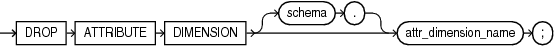

Purpose

Use the `DROP` `ATTRIBUTE` `DIMENSION` statement to drop an attribute dimension. An `ATTRIBUTE` `DIMENSION` object is a component of analytic views.

Prerequisites

To drop an attribute dimension in your own schema, you must have the `DROP` `ATTRIBUTE` `DIMENSION` system privilege. To drop an analytic view in another user's schema, you must have the `DROP` `ANY` `ATTRIBUTE` `DIMENSION` system privilege.

Syntax

drop\_attribute\_dimension::=



> ```
> DROP ATTRIBUTE DIMENSION [ schema. ] attr_dimension_name;
> ```


Semantics

schema

Specify the schema in which the attribute dimension exists. If you do not specify a schema, then Oracle Database looks for the attribute dimension in your own schema.

attr\_dimension\_name

Specify the name of the attribute dimension to drop.

Example

The following statement drops the specified attribute dimension object:

```
DROP ATTRIBUTE DIMENSION product_attr_dim;
```