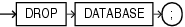

Purpose

Note:

You cannot roll back a `DROP` `DATABASE` statement.

Use the `DROP` `DATABASE` statement to drop the database. This statement is useful when you want to drop a test database or drop an old database after successful migration to a new host.

See Also:

[Oracle Database Backup and Recovery User's Guide](https://docs.oracle.com/pls/topic/lookup?ctx=en/database/oracle/oracle-database/12.2/sqlrf&id=BRADV89641) for more information on dropping the database

Prerequisites

You must have the `SYSDBA` system privilege to issue this statement. The database must be mounted in exclusive and restricted mode, and it must be closed.

Syntax

drop\_database::=



> ```
> DROP DATABASE ;
> ```


Semantics

When you issue this statement, Oracle Database drops the database and deletes all control files and data files listed in the control file. If the database used a server parameter file (spfile), then the spfile is also deleted.

Archived logs and backups are not removed, but you can use Recovery Manager (RMAN) to remove them. If the database is on raw disks, then this statement does not delete the actual raw disk special files.