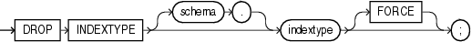

Purpose

Use the `DROP` `INDEXTYPE` statement to drop an indextype as well as any association with a statistics type.

See Also:

[CREATE INDEXTYPE](CREATE-INDEXTYPE.md) for more information on indextypes

Prerequisites

The indextype must be in your own schema or you must have the `DROP` `ANY` `INDEXTYPE` system privilege.

Syntax

drop\_indextype::=



> ```
> DROP INDEXTYPE [ schema. ] indextype [ FORCE ] ;
> ```


Semantics

schema

Specify the schema containing the indextype. If you omit `schema`, then Oracle Database assumes the indextype is in your own schema.

indextype

Specify the name of the indextype to be dropped.

If any statistics types have been associated with indextype, then the database disassociates the statistics type from the indextype and drops any statistics that have been collected using the statistics type.

See Also:

[ASSOCIATE STATISTICS](ASSOCIATE-STATISTICS.md) and [DISASSOCIATE STATISTICS](DISASSOCIATE-STATISTICS.md) for more information on statistics associations

FORCE

Specify `FORCE` to drop the indextype even if the indextype is currently being referenced by one or more domain indexes. Oracle Database marks those domain indexes `INVALID`. Without `FORCE`, you cannot drop an indextype if any domain indexes reference the indextype.

Examples

Dropping an Indextype: Example

The following statement drops the indextype `position_indextype`, created in " [Using Extensible Indexing](Using-Extensible-Indexing.md) ", and marks `INVALID` any domain indexes defined on this indextype:

```
DROP INDEXTYPE position_indextype FORCE;
```