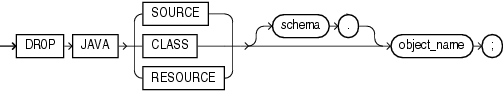

Purpose

Use the `DROP` `JAVA` statement to drop a Java source, class, or resource schema object.

See Also:

- [CREATE JAVA](CREATE-JAVA.md) for information on creating Java objects
- [Oracle Database Java Developer's Guide](https://docs.oracle.com/pls/topic/lookup?ctx=en/database/oracle/oracle-database/12.2/sqlrf&id=JJDEV02000) for more information on resolving Java sources, classes, and resources

Prerequisites

The Java source, class, or resource must be in your own schema or you must have the `DROP` `ANY` `PROCEDURE` system privilege. You also must have the `EXECUTE` object privilege on Java classes to use this command.

Syntax

drop\_java::=



> ```
> DROP JAVA { SOURCE | CLASS | RESOURCE }
>   [ schema. ] object_name ;
> ```


Semantics

JAVA SOURCE

Specify `SOURCE` to drop a Java source schema object and all Java class schema objects derived from it.

JAVA CLASS

Specify `CLASS` to drop a Java class schema object.

JAVA RESOURCE

Specify `RESOURCE` to drop a Java resource schema object.

object\_name

Specify the name of an existing Java class, source, or resource schema object. Enclose the `object_name` in double quotation marks to preserve lower- or mixed-case names.

Examples

Dropping a Java Class Object: Example

The following statement drops the Java class `Agent`, created in " [Creating a Java Class Object: Example](CREATE-JAVA.md) ":

```
DROP JAVA CLASS "Agent";
```