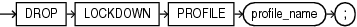

Purpose

Use the `DROP` `LOCKDOWN` `PROFILE` statement to remove a PDB lockdown profile from the database.

If the lockdown profile is the value of the `PDB_LOCKDOWN` initialization parameter for a CDB, an application root, or a PDB, then the effect of the lockdown profile will be disabled when you drop it. However, the lockdown profile will remain as the value of the `PDB_LOCKDOWN` initialization parameter. You can subsequently modify the `PDB_LOCKDOWN` parameter to unset the value of the dropped lockdown profile.

See Also:

- [CREATE LOCKDOWN PROFILE](CREATE-LOCKDOWN-PROFILE.md) and [ALTER LOCKDOWN PROFILE](ALTER-LOCKDOWN-PROFILE.md)
- [Oracle Database Security Guide](https://docs.oracle.com/pls/topic/lookup?ctx=en/database/oracle/oracle-database/12.2/sqlrf&id=DBSEG-GUID-AB5E62DB-7E2A-4B5A-BA96-A2BD2DF15275) for more information on PDB lockdown profiles

Prerequisites

The `DROP` `LOCKDOWN` `PROFILE` statement is valid only in a CDB. The current container must be the CDB root and you must have the `DROP` `LOCKDOWN` `PROFILE` system privilege, either granted commonly or granted locally in the CDB root.

Syntax

drop\_lockdown\_profile::=



> ```
> DROP LOCKDOWN PROFILE profile_name ;
> ```


Semantics

profile\_name

Specify the name of the PDB lockdown profile to be dropped.

You can find the names of existing PDB lockdown profiles by querying the `DBA_LOCKDOWN_PROFILES` data dictionary view.

See Also:

Oracle Database Reference for more information on the [`DBA_LOCKDOWN_PROFILES`](https://docs.oracle.com/pls/topic/lookup?ctx=en/database/oracle/oracle-database/12.2/sqlrf&id=REFRN-GUID-2DEBBEBC-7A6B-4984-A7E7-90314971182E) data dictionary view and the [`PDB_LOCKDOWN`](https://docs.oracle.com/pls/topic/lookup?ctx=en/database/oracle/oracle-database/12.2/sqlrf&id=REFRN-GUID-27072E94-1E1D-4BB0-AEAE-D7AFDC02E0A1) initialization parameter

Example

The following statement drops PDB lockdown profile `hr_prof`:

```
DROP LOCKDOWN PROFILE hr_prof;
```