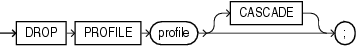

Purpose

Use the `DROP` `PROFILE` statement to remove a profile from the database. You can drop any profile except the `DEFAULT` profile.

See Also:

[CREATE PROFILE](CREATE-PROFILE.md) and [ALTER PROFILE](ALTER-PROFILE.md) on creating and modifying a profile

Prerequisites

You must have the `DROP` `PROFILE` system privilege.

Syntax

drop\_profile::=



> ```
> DROP PROFILE profile [ CASCADE ] ;
> ```


Semantics

profile

Specify the name of the profile to be dropped.

CASCADE

Specify `CASCADE` to deassign the profile from any users to whom it is assigned. Oracle Database automatically assigns the `DEFAULT` profile to such users. You must specify this clause to drop a profile that is currently assigned to users.

Examples

Dropping a Profile: Example

The following statement drops the profile `app_user`, which was created in " [Creating a Profile: Example](CREATE-PROFILE.md) ". Oracle Database drops the profile `app_user` and assigns the `DEFAULT` profile to any users currently assigned the `app_user` profile:

```
DROP PROFILE app_user CASCADE;
```