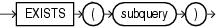

An `EXISTS` condition tests for existence of rows in a subquery.



> ```
> EXISTS (subquery)
> ```


Table 6-11 shows the `EXISTS` condition.

Table 6-11 EXISTS Condition

| Type of Condition | Operation | Example |
| --- | --- | --- |
| ``` EXISTS ``` | `TRUE` if a subquery returns at least one row. | ``` SELECT department_id   FROM departments d   WHERE EXISTS   (SELECT * FROM employees e     WHERE d.department_id      = e.department_id)    ORDER BY department_id; ``` |