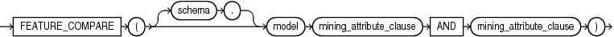
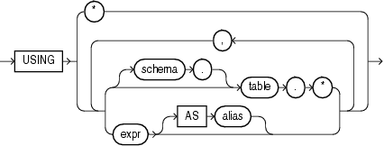

Syntax

feature\_compare::=



> ```
> FEATURE_COMPARE ( [ schema . ] model
>   mining_attribute_clause AND mining_attribute_clause )
> ```


mining\_attribute\_clause::=



> ```
> USING
> { * 
> | { [ schema . ] table . * 
>   | expr [ AS alias ]
>   }
>     [, { [ schema . ] table . * 
>        | expr [ AS alias ]
>        }
>     ]...
> }
> ```


Purpose

The `FEATURE_COMPARE` function uses a Feature Extraction model to compare two different documents, including short ones such as keyword phrases or two attribute lists, for similarity or dissimilarity. The `FEATURE_COMPARE` function can be used with Feature Extraction algorithms such as Singular Value Decomposition (SVD), Principal Component Analysis PCA), Non-Negative Matrix Factorization (NMF), and Explicit Semantic Analysis (ESA). This function is applicable not only to documents, but also to numeric and categorical data.

The input to the `FEATURE_COMPARE` function is a single feature model built using the Feature Extraction algorithms of Oracle Data Mining, such as NMF, SVD, and ESA. The double `USING` clause provides a mechanism to compare two different documents or constant keyword phrases, or any combination of the two, for similarity or dissimilarity using the extracted features in the model.

The syntax of the `FEATURE_COMPARE` function can use an optional `GROUPING` hint when scoring a partitioned model. See [GROUPING Hint](Comments.md).

mining\_attribute\_clause

The `mining_attribute_clause` identifies the column attributes to use as predictors for scoring. When the function is invoked with the analytic syntax, these predictors are also used for building the transient models. The `mining_attribute_clause` behaves as described for the `PREDICTION` function. See [mining\_attribute\_clause](PREDICTION.md).

See Also:

- [Oracle Data Mining User’s Guide](https://docs.oracle.com/pls/topic/lookup?ctx=en/database/oracle/oracle-database/12.2/sqlrf&id=DMPRG004) for information about scoring
- [Oracle Data Mining Concepts](https://docs.oracle.com/pls/topic/lookup?ctx=en/database/oracle/oracle-database/12.2/sqlrf&id=DMCON008) for information about clustering

Note:

The following examples are excerpted from the Data Mining sample programs. For more information about the sample programs, see Appendix A in [Oracle Data Mining User’s Guide](https://docs.oracle.com/pls/topic/lookup?ctx=en/database/oracle/oracle-database/12.2/sqlrf&id=DMPRG714).

Examples

An ESA model is built against a 2005 Wiki dataset rendering over 200,000 features. The documents are mined as text and the document titles are considered as the Feature IDs.

The examples show the `FEATURE_COMPARE` function with the ESA algorithm, which compares a similar set of texts and then a dissimilar set of texts.

Similar texts

```
SELECT 1-FEATURE_COMPARE(esa_wiki_mod USING 'There are several PGA tour golfers from South Africa' text AND USING 'Nick Price won the 2002 Mastercard Colonial Open' text) similarity FROM DUAL;

SIMILARITY
----------
      .258
```

The output metric shows the results of a distance calculation. Therefore, a smaller number represents more similar texts. So 1 minus the distance in the queries represents a document similarity metric.

Dissimilar texts

```
SELECT 1-FEATURE_COMPARE(esa_wiki_mod USING 'There are several PGA tour golfers from South Africa' text AND USING 'John Elway played quarterback for the Denver Broncos' text) similarity FROM DUAL;

SIMILARITY
----------
      .007
```