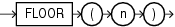

Syntax



> ```
> FLOOR(n)
> ```


Purpose

`FLOOR` returns the largest integer equal to or less than `n`. The number `n` can always be written as the sum of an integer `k` and a positive fraction `f` such that 0 <= `f` < 1 and `n` = `k` + `f`. The value of `FLOOR` is the integer `k`. Thus, the value of `FLOOR` is `n` itself if and only if `n` is precisely an integer.

This function takes as an argument any numeric data type or any nonnumeric data type that can be implicitly converted to a numeric data type. The function returns the same data type as the numeric data type of the argument.

See Also:

[Table 2-8](Data-Type-Comparison-Rules.md) for more information on implicit conversion and [CEIL](CEIL.md)

Examples

The following example returns the largest integer equal to or less than 15.7:

```
SELECT FLOOR(15.7) "Floor"
  FROM DUAL;

     Floor
----------
        15
```