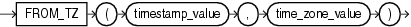

Syntax



> ```
> FROM_TZ(timestamp_value, time_zone_value)
> ```


Purpose

`FROM_TZ` converts a timestamp value and a time zone to a `TIMESTAMP` `WITH` `TIME` `ZONE` value. `time_zone_value` is a character string in the format `'TZH:TZM'` or a character expression that returns a string in `TZR` with optional `TZD` format.

Examples

The following example returns a timestamp value to `TIMESTAMP` `WITH` `TIME` `ZONE`:

```
SELECT FROM_TZ(TIMESTAMP '2000-03-28 08:00:00', '3:00') 
  FROM DUAL;

FROM_TZ(TIMESTAMP'2000-03-2808:00:00','3:00')
---------------------------------------------------------------
28-MAR-00 08.00.000000000 AM +03:00
```