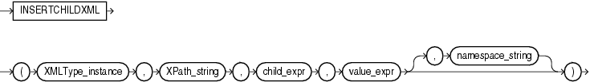

Note:

The `INSERTCHILDXML` function is deprecated. It is still supported for backward compatibility. However, Oracle recommends that you use XQuery Update instead. See [Oracle XML DB Developer's Guide](https://docs.oracle.com/pls/topic/lookup?ctx=en/database/oracle/oracle-database/12.2/sqlrf&id=ADXDB1700) for more information.

Syntax



> ```
> INSERTCHILDXML
>   ( XMLType_instance, XPath_string, child_expr, value_expr [, namespace_string ])
> ```


Purpose

`INSERTCHILDXML` inserts a user-supplied value into the target XML at the node indicated by the XPath expression. Compare this function with [INSERTXMLBEFORE](INSERTXMLBEFORE.md).

- `XMLType_instance` is an instance of `XMLType`.
- `XPath_string` is an Xpath expression indicating one or more nodes into which the one or more child nodes are to be inserted. You can specify an absolute `XPath_string` with an initial slash or a relative `XPath_string` by omitting the initial slash. If you omit the initial slash, then the context of the relative path defaults to the root node.
- `child_expr` specifies the one or more element or attribute nodes to be inserted.
- `value_expr` is an fragment of `XMLType` that specifies one or more notes being inserted. It must resolve to a string.
- The optional `namespace_string` provides namespace information for the `XPath_string`. This parameter must be of type `VARCHAR2`.

See Also:

[Oracle XML DB Developer's Guide](https://docs.oracle.com/pls/topic/lookup?ctx=en/database/oracle/oracle-database/12.2/sqlrf&id=ADXDB0440) for more information about this function

Examples

The following example adds a second `/Owner` node to the `warehouse_spec` of one of the warehouses updated in the example for [APPENDCHILDXML](APPENDCHILDXML.md):

```
UPDATE warehouses
  SET warehouse_spec = INSERTCHILDXML(warehouse_spec, '/Warehouse/Building',
    'Owner', XMLType('<Owner>LesserCo</Owner>'))
  WHERE warehouse_id = 3;

SELECT warehouse_spec
  FROM warehouses  WHERE warehouse_id = 3;

WAREHOUSE_SPEC
----------------------------------------------------------------------------
<?xml version="1.0"?>
<Warehouse>
  <Building>Rented
    <Owner>Grandco</Owner>
    <Owner>LesserCo</Owner>
  </Building>
  <Area>85700</Area>
  <DockType/>
  <WaterAccess>N</WaterAccess>
  <RailAccess>N</RailAccess>
  <Parking>Street</Parking>
  <VClearance>11.5 ft</VClearance>
</Warehouse>
```