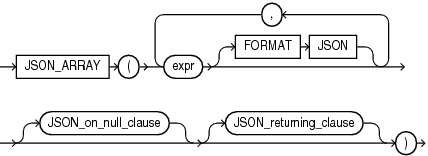

Syntax



> ```
> JSON_ARRAY
>   ( expr [ FORMAT JSON ] [, expr [ FORMAT JSON ] ]...
>     [ JSON_on_null_clause ] [ JSON_returning_clause ]
>   )
> ```


JSON\_on\_null\_clause::=


> ```
> { NULL | ABSENT } ON NULL
> ```


JSON\_returning\_clause::=


> ```
> RETURNING VARCHAR2 [ ( size [BYTE | CHAR] ) ]
> ```


Purpose

The SQL/JSON function `JSON_ARRAY` takes as its input one or more SQL expressions, converts each expression to a JSON value, and returns a JSON array that contains those JSON values.

expr

For `expr`, you can specify any SQL expression that evaluates to a JSON object, a JSON array, a numeric literal, a text literal, or null. This function converts a numeric literal to a JSON number value and a text literal to a JSON string value.

FORMAT JSON

This clause is optional and is provided for semantic clarity.

JSON\_on\_null\_clause

Use this clause to specify the behavior of this function when `expr` evaluates to null.

- `NULL` `ON` `NULL` - If you specify this clause, then the function returns the JSON null value.
- `ABSENT` `ON` `NULL` - If you specify this clause, then the function omits the value from the JSON array. This is the default.

JSON\_returning\_clause

The character string returned by this function is of data type `VARCHAR2`. This clause allows you to specify the size of the `VARCHAR2` data type. Use `BYTE` to specify the size as a number of bytes or `CHAR` to specify the size as a number of characters. The default is `BYTE`. If you omit this clause, or if you specify this clause but omit the `size` value, then `JSON_ARRAY` returns a character string of type `VARCHAR2(4000)`.

Refer to [VARCHAR2 Data Type](Data-Types.md) for more information. Note that when specifying the `VARCHAR2` data type elsewhere in SQL, you are required to specify a size. However, in the `JSON_returning_clause` you can omit the size.

Examples

The following example constructs a JSON array from a JSON object, a JSON array, a numeric literal, a text literal, and null:

```
SELECT JSON_ARRAY (     
    JSON_OBJECT('percentage' VALUE .50),
    JSON_ARRAY(1,2,3),
    100,
    'California',
    null
    NULL ON NULL
    ) "JSON Array Example"
  FROM DUAL;
 
JSON Array Example
--------------------------------------------------------------------------------
[{"percentage":0.5},[1,2,3],100,"California",null]
```