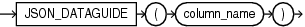

Syntax



> ```
> JSON_DATAGUIDE (column_name)
> ```


Purpose

The Oracle SQL function `JSON_DATAGUIDE` takes as its input a table column of JSON data. Each row in the column is referred to as a JSON document. For each JSON document in the column, this function returns a `CLOB` value that contains a flat data guide for that JSON document.

column\_name

Specify the name of the column of JSON data for which you would like to create data guides.

Restriction on JSON\_DATAGUIDE

You cannot run this function on a shard catalog server.

See Also:

[Oracle Database JSON Developer's Guide](https://docs.oracle.com/pls/topic/lookup?ctx=en/database/oracle/oracle-database/12.2/sqlrf&id=ADJSN-GUID-219FC30E-89A7-4189-BC36-7B961A24067C) for more information on data guides

Examples

The following example uses the `j_purchaseorder` table, which is created in " [Creating a Table That Contains a JSON Document: Example](JSON_TABLE.md) ". This table contains a column of JSON data called `po_document`. This examples returns a flat data guide for each JSON document in the column `po_document`.

```
SELECT EXTRACT(YEAR FROM date_loaded) YEAR,
       JSON_DATAGUIDE(po_document) "DATA GUIDE"
  FROM j_purchaseorder
  GROUP BY extract(YEAR FROM date_loaded)
  ORDER BY extract(YEAR FROM date_loaded) DESC;

YEAR DATA GUIDE
---- ------------------------------------------
2016 [
       {
         "o:path" : "$.PO_ID",
         "type" : "number",
         "o:length" : 4
       },
       {
         "o:path" : "$.PO_Ref",
         "type" : "string",
         "o:length" : 16
       },
       {
         "o:path" : "$.PO_Items",
         "type" : "array",
         "o:length" : 64
       },
       {
         "o:path" : "$.PO_Items.Part_No",
         "type" : "number",
         "o:length" : 16
       },
       {
         "o:path" : "$.PO_Items.Item_Quantity",
         "type" : "number",
         "o:length" : 2
       }
     ]
. . .
```