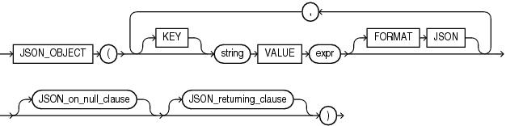
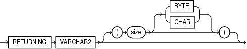

Syntax



> ```
> JSON_OBJECT
>   ( [ KEY ] string VALUE expr [ FORMAT JSON ]
>       [, [ KEY ] string VALUE expr [ FORMAT JSON ] ]...
>     [ JSON_on_null_clause ] [ JSON_returning_clause ]
>   )
> ```


JSON\_on\_null\_clause::=


> ```
> { NULL | ABSENT } ON NULL
> ```


JSON\_returning\_clause::=



> ```
> RETURNING VARCHAR2 [ ( size [BYTE | CHAR] ) ]
> ```


Purpose

The SQL/JSON function `JSON_OBJECT` takes as its input one or more property key-value pairs. It returns a JSON object that contains an object member for each of those key-value pairs.

\[KEY\] string VALUE expr

Use this clause to specify a property key-value pair.

- `KEY` is optional and is provided for semantic clarity.
- Use `string` to specify the property key name as a case-sensitive text literal.
- Use `expr` to specify the property value. For `expr`, you can specify any expression that evaluates to a SQL numeric literal or text literal. If `expr` evaluates to a numeric literal, then the resulting property value is a JSON number value; otherwise, the resulting property value is a case-sensitive JSON string value enclosed in double quotation marks.

FORMAT JSON

Specify `FORMAT JSON` after an input expression to declare that the value that results from it represents JSON data, and will therefore not be quoted in the output

JSON\_on\_null\_clause

Use this clause to specify the behavior of this function when `expr` evaluates to null.

- `NULL` `ON` `NULL` - If you specify this clause, then the function returns the JSON null value. This is the default.
- `ABSENT` `ON` `NULL` - If you specify this clause, then the function omits the property key-value pair from the JSON object.

JSON\_returning\_clause

The character string returned by this function is of data type `VARCHAR2`. This clause allows you to specify the size of the `VARCHAR2` data type. Use `BYTE` to specify the size as a number of bytes or `CHAR` to specify the size as a number of characters. The default is `BYTE`. If you omit this clause, or if you specify this clause but omit the `size` value, then `JSON_OBJECT` returns a character string of type `VARCHAR2(4000)`.

Refer to [VARCHAR2 Data Type](Data-Types.md) for more information. Note that when specifying the `VARCHAR2` data type elsewhere in SQL, you are required to specify a size. However, in the `JSON_returning_clause` you can omit the size.

Example

The following example returns JSON objects that each contain two property key-value pairs:

```
SELECT JSON_OBJECT (
    KEY 'deptno' IS d.department_id,
    KEY 'deptname' IS d.department_name 
    ) "Department Objects"
  FROM departments d
  ORDER BY d.department_id;

Department Objects
----------------------------------------
{"deptno":10,"deptname":"Administration"}
{"deptno":20,"deptname":"Marketing"}
{"deptno":30,"deptname":"Purchasing"}
{"deptno":40,"deptname":"Human Resources"}
{"deptno":50,"deptname":"Shipping"}
. . .
```

See Also:

[Generation of JSON Data With SQL/JSON Functions](https://docs.oracle.com/pls/topic/lookup?ctx=en/database/oracle/oracle-database/12.2/sqlrf&id=ADJSN-GUID-6C3441E8-4F02-4E95-969C-BBCA6BDBBD9A)