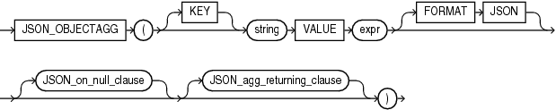
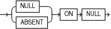
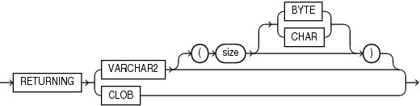

Syntax



> ```
> JSON_OBJECTAGG
>   ( [ KEY ] string VALUE expr [ FORMAT JSON ]
>     [ JSON_on_null_clause ] [ JSON_agg_returning_clause ]
>   )
> ```


JSON\_on\_null\_clause::=



> ```
> { NULL | ABSENT } ON NULL
> ```


JSON\_agg\_returning\_clause::=



> ```
> RETURNING { VARCHAR2 [ ( size [BYTE | CHAR] ) ]
>           | CLOB
>           }
> ```


Purpose

The SQL/JSON function `JSON_OBJECTAGG` is an aggregate function. It takes as its input a property key-value pair. Typically, the property key, the property value, or both are columns of SQL expressions. This function constructs an object member for each key-value pair and returns a single JSON object that contains those object members.

\[KEY\] string VALUE expr

Use this clause to specify property key-value pairs.

- `KEY` is optional and is provided for semantic clarity.
- Use `string` to specify the property key name as a case-sensitive text literal.
- Use `expr` to specify the property value. For `expr`, you can specify any expression that evaluates to a SQL numeric literal or text literal. If `expr` evaluates to a numeric literal, then the resulting property value is a JSON number value; otherwise, the resulting property value is a case-sensitive JSON string value enclosed in double quotation marks.

FORMAT JSON

This clause is optional and is provided for semantic clarity.

JSON\_on\_null\_clause

Use this clause to specify the behavior of this function when `expr` evaluates to null.

- `NULL` `ON` `NULL` - If you specify this clause, then the function returns the JSON null value. This is the default.
- `ABSENT` `ON` `NULL` - If you specify this clause, then the function omits the property key-value pair from the JSON object.

JSON\_agg\_returning\_clause

Use this clause to specify the data type of the character string returned by this function. You can specify the following data types:

- `VARCHAR2[(``size` `[BYTE,CHAR])]`
	When specifying the `VARCHAR2` data type elsewhere in SQL, you are required to specify a size. However, in this clause you can omit the size.
- `CLOB`

If you omit this clause, or if you specify `VARCHAR2` but omit the `size` value, then `JSON_OBJECTAGG` returns a character string of type `VARCHAR2(4000)`.

Refer to " [Data Types](Data-Types.md) " for more information on the preceding data types.

Examples

The following example constructs a JSON object whose members contain department names and department numbers:

```
SELECT JSON_OBJECTAGG(KEY department_name VALUE department_id) "Department Numbers"
  FROM departments
  WHERE department_id <= 30;

Department Numbers
----------------------------------------------------
{"Administration":10,"Marketing":20,"Purchasing":30}
```