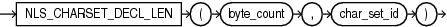

Syntax



> ```
> NLS_CHARSET_DECL_LEN(byte_count, char_set_id)
> ```


Purpose

`NLS_CHARSET_DECL_LEN` returns the declaration length (in number of characters) of an `NCHAR` column. The `byte_count` argument is the width of the column. The `char_set_id` argument is the character set ID of the column.

Examples

The following example returns the number of characters that are in a 200-byte column when you are using a multibyte character set:

```
SELECT NLS_CHARSET_DECL_LEN(200, nls_charset_id('ja16eucfixed')) 
  FROM DUAL; 

NLS_CHARSET_DECL_LEN(200,NLS_CHARSET_ID('JA16EUCFIXED'))
--------------------------------------------------------
                                                     100
```