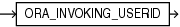

Syntax



> ```
> ORA_INVOKING_USERID
> ```


Purpose

`ORA_INVOKING_USERID` returns the identifier of the database user who invoked the current statement or view. This function takes into account the `BEQUEATH` property of intervening views referenced in the statement.

This function returns a `NUMBER` value.

See Also:

- [ORA\_INVOKING\_USER](ORA_INVOKING_USER.md) to learn how Oracle Database determines the database user who invoked the current statement or view
- [BEQUEATH](CREATE-VIEW.md) clause of the `CREATE` `VIEW` statement

Examples

The following example returns the identifier of the database user who invoked the statement:

```
SELECT ORA_INVOKING_USERID FROM DUAL;
```