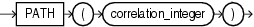

Syntax



> ```
> PATH(correlation_integer)
> ```


Purpose

`PATH` is an ancillary function used only with the `UNDER_PATH` and `EQUALS_PATH` conditions. It returns the relative path that leads to the resource specified in the parent condition.

The `correlation_integer` can be any `NUMBER` integer and is used to correlate this ancillary function with its primary condition. Values less than 1 are treated as 1.

See Also:

- [EQUALS\_PATH Condition](XML-Conditions.md) and [UNDER\_PATH Condition](XML-Conditions.md)
- Appendix C in [Oracle Database Globalization Support Guide](https://docs.oracle.com/pls/topic/lookup?ctx=en/database/oracle/oracle-database/12.2/sqlrf&id=NLSPG-GUID-AFCE41ED-775B-4A00-AF38-C436776AE0C5) for the collation derivation rules, which define the collation assigned to the character return value of `PATH`

Examples

Refer to the related function [DEPTH](DEPTH.md) for an example using both of these ancillary functions of the `EQUALS_PATH` and `UNDER_PATH` conditions.