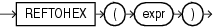

Syntax



> ```
> REFTOHEX (expr)
> ```


Purpose

`REFTOHEX` converts argument `expr` to a character value containing its hexadecimal equivalent. `expr` must return a `REF`.

Examples

The sample schema `oe` contains a `warehouse_typ`. The following example builds on that type to illustrate how to convert the `REF` value of a column to a character value containing its hexadecimal equivalent:

```
CREATE TABLE warehouse_table OF warehouse_typ
   (PRIMARY KEY (warehouse_id));

CREATE TABLE location_table
   (location_number NUMBER, building REF warehouse_typ 
   SCOPE IS warehouse_table);

INSERT INTO warehouse_table VALUES (1, 'Downtown', 99);

INSERT INTO location_table SELECT 10, REF(w) FROM warehouse_table w;

SELECT REFTOHEX(building) FROM location_table;

REFTOHEX(BUILDING)
--------------------------------------------------------------------------
0000220208859B5E9255C31760E034080020825436859B5E9255C21760E034080020825436
```