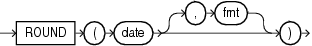

Syntax

round\_date::=



> ```
> ROUND(date [, fmt ])
> ```


Purpose

`ROUND` returns `date` rounded to the unit specified by the format model `fmt`. This function is not sensitive to the `NLS_CALENDAR` session parameter. It operates according to the rules of the Gregorian calendar. The value returned is always of data type `DATE`, even if you specify a different datetime data type for `date`. If you omit `fmt`, then `date` is rounded to the nearest day. The `date` expression must resolve to a `DATE` value.

See Also:

" [ROUND and TRUNC Date Functions](ROUND-and-TRUNC-Date-Functions.md) " for the permitted format models to use in `fmt`

Examples

The following example rounds a date to the first day of the following year:

```
SELECT ROUND (TO_DATE ('27-OCT-00'),'YEAR')
   "New Year" FROM DUAL;
 
New Year
---------
01-JAN-01
```