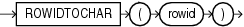

Syntax



> ```
> ROWIDTOCHAR(rowid)
> ```


Purpose

`ROWIDTOCHAR` converts a rowid value to `VARCHAR2` data type. The result of this conversion is always 18 characters long.

See Also:

Appendix C in [Oracle Database Globalization Support Guide](https://docs.oracle.com/pls/topic/lookup?ctx=en/database/oracle/oracle-database/12.2/sqlrf&id=NLSPG-GUID-AFCE41ED-775B-4A00-AF38-C436776AE0C5) for the collation derivation rules, which define the collation assigned to the character return value of `ROWIDTOCHAR`

Examples

The following example converts a rowid value in the `employees` table to a character value. (Results vary for each build of the sample database.)

```
SELECT ROWID FROM employees 
   WHERE ROWIDTOCHAR(ROWID) LIKE '%JAAB%'
   ORDER BY ROWID;

ROWID
------------------
AAAFfIAAFAAAABSAAb
```