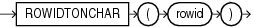

Syntax



> ```
> ROWIDTONCHAR(rowid)
> ```


Purpose

`ROWIDTONCHAR` converts a rowid value to `NVARCHAR2` data type. The result of this conversion is always in the national character set and is 18 characters long.

See Also:

Appendix C in [Oracle Database Globalization Support Guide](https://docs.oracle.com/pls/topic/lookup?ctx=en/database/oracle/oracle-database/12.2/sqlrf&id=NLSPG-GUID-AFCE41ED-775B-4A00-AF38-C436776AE0C5) for the collation derivation rules, which define the collation assigned to the character return value of `ROWIDTONCHAR`

Examples

The following example converts a rowid value to an `NVARCHAR2` string:

```
SELECT LENGTHB( ROWIDTONCHAR(ROWID) ) Length, ROWIDTONCHAR(ROWID) 
   FROM employees
   ORDER BY length; 

    LENGTH ROWIDTONCHAR(ROWID
---------- ------------------
        36 AAAL52AAFAAAABSABD
        36 AAAL52AAFAAAABSABV
. . .
```