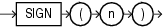

Syntax



> ```
> SIGN(n)
> ```


Purpose

`SIGN` returns the sign of `n`. This function takes as an argument any numeric data type, or any nonnumeric data type that can be implicitly converted to `NUMBER`, and returns `NUMBER`.

For value of `NUMBER` type, the sign is:

- \-1 if `n` <0
- 0 if `n` =0
- 1 if `n` >0

For binary floating-point numbers (`BINARY_FLOAT` and `BINARY_DOUBLE`), this function returns the sign bit of the number. The sign bit is:

- \-1 if `n` <0
- +1 if `n` >=0 or `n` = `NaN`

Examples

The following example indicates that the argument of the function (`-15`) is <0:

```
SELECT SIGN(-15) "Sign" FROM DUAL;

      Sign
----------
        -1
```