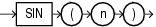

Syntax



> ```
> SIN(n)
> ```


Purpose

`SIN` returns the sine of `n` (an angle expressed in radians).

This function takes as an argument any numeric data type or any nonnumeric data type that can be implicitly converted to a numeric data type. If the argument is `BINARY_FLOAT`, then the function returns `BINARY_DOUBLE`. Otherwise the function returns the same numeric data type as the argument.

See Also:

[Table 2-8](Data-Type-Comparison-Rules.md) for more information on implicit conversion

Examples

The following example returns the sine of 30 degrees:

```
SELECT SIN(30 * 3.14159265359/180)
 "Sine of 30 degrees" FROM DUAL;

Sine of 30 degrees
------------------
                .5
```