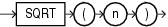

Syntax



> ```
> SQRT(n)
> ```


Purpose

`SQRT` returns the square root of `n`.

This function takes as an argument any numeric data type or any nonnumeric data type that can be implicitly converted to a numeric data type. The function returns the same data type as the numeric data type of the argument.

See Also:

[Table 2-8](Data-Type-Comparison-Rules.md) for more information on implicit conversion

- If `n` resolves to a `NUMBER`, then the value `n` cannot be negative. `SQRT` returns a real number.
- If `n` resolves to a binary floating-point number (`BINARY_FLOAT` or `BINARY_DOUBLE`):
	- If `n` >= 0, then the result is positive.
		- If `n` = -0, then the result is -0.
		- If `n` < 0, then the result is `NaN`.

Examples

The following example returns the square root of 26:

```
SELECT SQRT(26) "Square root" FROM DUAL;

Square root
-----------
5.09901951
```