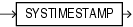

Syntax



> ```
> SYSTIMESTAMP
> ```


Purpose

`SYSTIMESTAMP` returns the system date, including fractional seconds and time zone, of the system on which the database resides. The return type is `TIMESTAMP` `WITH` `TIME` `ZONE`.

Examples

The following example returns the system timestamp:

```
SELECT SYSTIMESTAMP FROM DUAL;

SYSTIMESTAMP
------------------------------------------------------------------
28-MAR-00 12.38.55.538741 PM -08:00
```

The following example shows how to explicitly specify fractional seconds:

```
SELECT TO_CHAR(SYSTIMESTAMP, 'SSSSS.FF') FROM DUAL;

TO_CHAR(SYSTIME
---------------
55615.449255
```

The following example returns the current timestamp in a specified time zone:

```
SELECT SYSTIMESTAMP AT TIME ZONE 'UTC' FROM DUAL;
 
SYSTIMESTAMPATTIMEZONE'UTC'
---------------------------------------------------------------------------
08-07-21 20:39:52,743557 UTC
```

The output format in this example depends on the `NLS_TIMESTAMP_TZ_FORMAT` for the session.