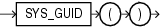

Syntax



> ```
> SYS_GUID( )
> ```


Purpose

`SYS_GUID` generates and returns a globally unique identifier (`RAW` value) made up of 16 bytes. On most platforms, the generated identifier consists of a host identifier, a process or thread identifier of the process or thread invoking the function, and a nonrepeating value (sequence of bytes) for that process or thread.

Examples

The following example adds a column to the sample table `hr.locations`, inserts unique identifiers into each row, and returns the 32-character hexadecimal representation of the 16-byte `RAW` value of the global unique identifier:

```
ALTER TABLE locations ADD (uid_col RAW(16));

UPDATE locations SET uid_col = SYS_GUID();

SELECT location_id, uid_col FROM locations
   ORDER BY location_id, uid_col;

LOCATION_ID UID_COL
----------- ----------------------------------------------------------------
       1000 09F686761827CF8AE040578CB20B7491
       1100 09F686761828CF8AE040578CB20B7491
       1200 09F686761829CF8AE040578CB20B7491
       1300 09F68676182ACF8AE040578CB20B7491
       1400 09F68676182BCF8AE040578CB20B7491
       1500 09F68676182CCF8AE040578CB20B7491
. . .
```