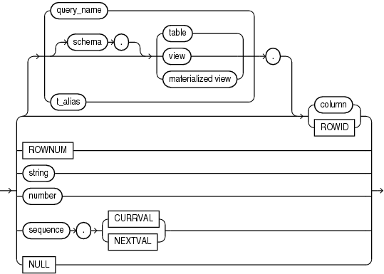

A simple expression specifies a column, pseudocolumn, constant, sequence number, or null.

simple\_expression::=



> ```
> { [ query_name.
>   | [schema.] { table. | view. | materialized view. }
>   | t_alias.
>   ] { column | ROWID }
> | ROWNUM
> | string
> | number
> | sequence. { CURRVAL | NEXTVAL }
> | NULL
> }
> ```


In addition to the schema of a user, `schema` can also be " `PUBLIC` " (double quotation marks required), in which case it must qualify a public synonym for a table, view, or materialized view. Qualifying a public synonym with " `PUBLIC` " is supported only in data manipulation language (DML) statements, not data definition language (DDL) statements.

You can specify `ROWID` only with a table, not with a view or materialized view. `NCHAR` and `NVARCHAR2` are not valid pseudocolumn data types.

See Also:

[Pseudocolumns](Pseudocolumns.md) for more information on pseudocolumns and [subquery\_factoring\_clause](SELECT.md) for information on `query_name`

Some valid simple expressions are:

```
employees.last_name 
'this is a text string'
10 
N'this is an NCHAR string'
```