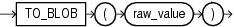

Syntax

to\_blob::=



> ```
> TO_BLOB ( raw_value )
> ```


Purpose

`TO_BLOB` (raw) converts `LONG` `RAW` and `RAW` values to `BLOB` values.

From within a PL/SQL package, you can use `TO_BLOB` (raw) to convert `RAW` and `BLOB` values to `BLOB`.

Examples

The following hypothetical example returns the `BLOB` of a `RAW` column value:

```
SELECT TO_BLOB(raw_column) blob FROM raw_table;

BLOB
-----------------------
00AADD343CDBBD
```