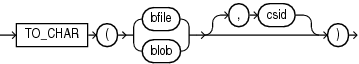

Syntax

to\_char\_bfile\_blob::=



> ```
> TO_CHAR( { bfile | blob } [, csid] )
> ```


Purpose

`TO_CHAR` (bfile|blob) converts `BFILE` or `BLOB` data to the database character set. The value returned is always `VARCHAR2`. If the value returned is too large to fit into the `VARCHAR2` data type, then the data is truncated.

For `csid`, specify the character set ID of the `BFILE` or `BLOB` data. If the character set of the `BFILE` or `BLOB` data is the database character set, then you can specify a value of 0 for `csid`, or omit `csid` altogether.

See Also:

Appendix C in [Oracle Database Globalization Support Guide](https://docs.oracle.com/pls/topic/lookup?ctx=en/database/oracle/oracle-database/12.2/sqlrf&id=NLSPG-GUID-AFCE41ED-775B-4A00-AF38-C436776AE0C5) for the collation derivation rules, which define the collation assigned to the character return value of this function

Example

The following hypothetical example takes as its input a `BFILE` column `media_col` in table `media_tab`, which uses the character set with ID 873. The example returns a `VARCHAR2` value that uses the database character set.

```
SELECT TO_CHAR(media_col, 873) FROM media_tab;
```