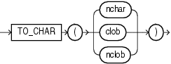

Syntax

to\_char\_char::=



> ```
> TO_CHAR(nchar | clob | nclob)
> ```


Purpose

`TO_CHAR` (character) converts `NCHAR`, `NVARCHAR2`, `CLOB`, or `NCLOB` data to the database character set. The value returned is always `VARCHAR2`.

When you use this function to convert a character LOB into the database character set, if the LOB value to be converted is larger than the target type, then the database returns an error.

See Also:

Appendix C in [Oracle Database Globalization Support Guide](https://docs.oracle.com/pls/topic/lookup?ctx=en/database/oracle/oracle-database/12.2/sqlrf&id=NLSPG-GUID-AFCE41ED-775B-4A00-AF38-C436776AE0C5) for the collation derivation rules, which define the collation assigned to the character return value of this function

Examples

The following example interprets a simple string as character data:

```
SELECT TO_CHAR('01110') FROM DUAL;

TO_CH
-----
01110
```

Compare this example with the first example for [TO\_CHAR (number)](TO_CHAR-number.md).

The following example converts some `CLOB` data from the `pm.print_media` table to the database character set:

```
SELECT TO_CHAR(ad_sourcetext) FROM print_media
      WHERE product_id = 2268;

TO_CHAR(AD_SOURCETEXT)
--------------------------------------------------------------------
******************************
TIGER2 2268...Standard Hayes Compatible Modem
Product ID: 2268
The #1 selling modem in the universe! Tiger2's modem includes call management
and Internet voicing. Make real-time full duplex phone calls at the same time
you're online.
**********************************
```