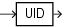

Syntax



> ```
> UID
> ```


Purpose

`UID` returns an integer that uniquely identifies the session user (the user who logged on).

See Also:

[USER](USER.md) to learn how Oracle Database determines the session user

Examples

The following example returns the UID of the session user:

```
SELECT UID FROM DUAL;
```