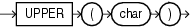

Syntax



> ```
> UPPER(char)
> ```


Purpose

`UPPER` returns `char`, with all letters uppercase. `char` can be any of the data types `CHAR`, `VARCHAR2`, `NCHAR`, `NVARCHAR2`, `CLOB`, or `NCLOB`. The return value is the same data type as `char`. The database sets the case of the characters based on the binary mapping defined for the underlying character set. For linguistic-sensitive uppercase, refer to [NLS\_UPPER](NLS_UPPER.md).

See Also:

Appendix C in [Oracle Database Globalization Support Guide](https://docs.oracle.com/pls/topic/lookup?ctx=en/database/oracle/oracle-database/12.2/sqlrf&id=NLSPG-GUID-AFCE41ED-775B-4A00-AF38-C436776AE0C5) for the collation derivation rules, which define the collation assigned to the character return value of `UPPER`

Examples

The following example returns each employee's last name in uppercase:

```
SELECT UPPER(last_name) "Uppercase"
   FROM employees;
```