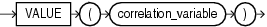

Syntax



> ```
> VALUE(correlation_variable)
> ```


Purpose

`VALUE` takes as its argument a correlation variable (table alias) associated with a row of an object table and returns object instances stored in the object table. The type of the object instances is the same type as the object table.

Examples

The following example uses the sample table `oe.persons`, which is created in " [Substitutable Table and Column Examples](CREATE-TABLE.md) ":

```
SELECT VALUE(p) FROM persons p;

VALUE(P)(NAME, SSN)
-------------------------------------------------------------
PERSON_T('Bob', 1234)
EMPLOYEE_T('Joe', 32456, 12, 100000)
PART_TIME_EMP_T('Tim', 5678, 13, 1000, 20)
```

See Also:

" [IS OF type Condition](IS-OF-type-Condition.md) " for information on using `IS` `OF` type conditions with the `VALUE` function