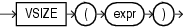

Syntax



> ```
> VSIZE(expr)
> ```


Purpose

`VSIZE` returns the number of bytes in the internal representation of `expr`. If `expr` is null, then this function returns null.

This function does not support `CLOB` data directly. However, `CLOB` s can be passed in as arguments through implicit data conversion.

See Also:

" [Data Type Comparison Rules](Data-Type-Comparison-Rules.md) " for more information

Examples

The following example returns the number of bytes in the `last_name` column of the employees in department 10:

```
SELECT last_name, VSIZE (last_name) "BYTES"      
  FROM employees
  WHERE department_id = 10
  ORDER BY employee_id;
 
LAST_NAME            BYTES
--------------- ----------
Whalen                   6
```