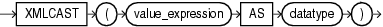

Syntax



> ```
> XMLCAST ( value_expression AS datatype )
> ```


Purpose

`XMLCast` casts `value_expression` to the scalar SQL data type specified by `datatype`. The `value_expression` argument is a SQL expression that is evaluated. The `datatype` argument can be of data type `NUMBER`, `VARCHAR2`, `CHAR`, `CLOB`, `BLOB`, `REF` `XMLTYPE`, and any of the datetime data types.

See Also:

- [Oracle XML DB Developer's Guide](https://docs.oracle.com/pls/topic/lookup?ctx=en/database/oracle/oracle-database/12.2/sqlrf&id=ADXDB0400) for more information on uses for this function and examples
- Appendix C in [Oracle Database Globalization Support Guide](https://docs.oracle.com/pls/topic/lookup?ctx=en/database/oracle/oracle-database/12.2/sqlrf&id=NLSPG-GUID-AFCE41ED-775B-4A00-AF38-C436776AE0C5) for the collation derivation rules, which define the collation assigned to the return value of `XMLCAST` when it is a character value