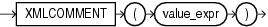

Syntax



> ```
> XMLCOMMENT ( value_expr )
> ```


Purpose

`XMLComment` generates an XML comment using an evaluated result of `value_expr`. The `value_expr` must resolve to a string. It cannot contain two consecutive dashes (hyphens). The value returned by the function takes the following form:

```
<!--string-->
```

If `value_expr` resolves to null, then the function returns null.

See Also:

[Oracle XML DB Developer's Guide](https://docs.oracle.com/pls/topic/lookup?ctx=en/database/oracle/oracle-database/12.2/sqlrf&id=ADXDB1620) for more information on this function

Examples

The following example uses the `DUAL` table to illustrate the `XMLComment` syntax:

```
SELECT XMLCOMMENT('OrderAnalysisComp imported, reconfigured, disassembled')
   AS "XMLCOMMENT" FROM DUAL;
 
XMLCOMMENT
--------------------------------------------------------------------------------
<!--OrderAnalysisComp imported, reconfigured, disassembled-->
```