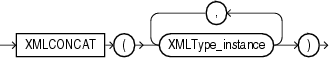

Syntax



> ```
> XMLCONCAT(XMLType_instance [, XMLType_instance ]...)
> ```


Purpose

`XMLConcat` takes as input a series of `XMLType` instances, concatenates the series of elements for each row, and returns the concatenated series. `XMLConcat` is the inverse of `XMLSequence`.

Null expressions are dropped from the result. If all the value expressions are null, then the function returns null.

See Also:

[XMLSEQUENCE](XMLSEQUENCE.md)

Examples

The following example creates XML elements for the first and last names of a subset of employees, and then concatenates and returns those elements:

```
SELECT XMLCONCAT(XMLELEMENT("First", e.first_name),
   XMLELEMENT("Last", e.last_name)) AS "Result"
   FROM employees e
   WHERE e.employee_id > 202;

Result
----------------------------------------------------------------
<First>Susan</First>
<Last>Mavris</Last>

<First>Hermann</First>
<Last>Baer</Last>

<First>Shelley</First>
<Last>Higgins</Last>

<First>William</First>
<Last>Gietz</Last>

4 rows selected.
```