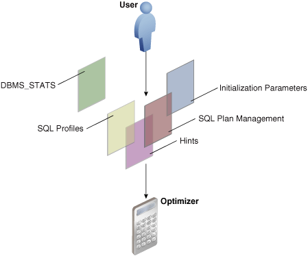
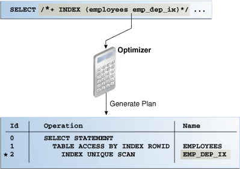

Optimizer defaults are adequate for most operations, but not all.

In some cases you may have information unknown to the optimizer, or need to tune the optimizer for a specific type of statement or workload. In such cases, influencing the optimizer may provide better performance.

This chapter contains the following topics:

### 19.1 Techniques for Influencing the Optimizer

You can influence the optimizer using several techniques, including SQL profiles, SQL Plan Management, initialization parameters, and hints.

The following figure shows the principal techniques for influencing the optimizer.

Figure 19-1 Techniques for Influencing the Optimizer



> This graphic depicts a user with an arrow pointing downward to five squares: DBMS\_STATS, SQL Profiles, Hints, SQL Plan Management, and Initialization Parameters. An arrow points down from these squares to the Optimizer icon, which looks like a calculator.


The overlapping squares in the preceding diagram show that SQL plan management uses both initialization parameters and hints. SQL profiles also technically include hints.

Note:

A [stored outline](glossary.md) is a legacy technique that serve a similar purpose to SQL plan baselines.

You can use the following techniques to influence the optimizer:

Table 19-1 Optimizer Techniques

| Technique | Description | To Learn More |
| --- | --- | --- |
| Initialization parameters | Parameters influence many types of optimizer behavior at the database instance and session level. | " Influencing the Optimizer with Initialization Parameters " |
| Hints | A [hint](glossary.md) is a commented instruction in a SQL statement. Hints control a wide range of behavior. | " Influencing the Optimizer with Hints " |
| `DBMS_STATS` | This package updates and manages optimizer statistics. The more accurate the statistics, the better the optimizer estimates. This chapter does not cover `DBMS_STATS`. | " [Gathering Optimizer Statistics](gathering-optimizer-statistics.md) " |
| SQL profiles | A [SQL profile](glossary.md) is a database object that contains auxiliary statistics specific to a SQL statement. Conceptually, a SQL profile is to a SQL statement what a set of object-level statistics is to a table or index. A SQL profile can correct suboptimal optimizer estimates discovered during SQL tuning. | " [Managing SQL Profiles](managing-sql-profiles.md) " |
| SQL plan management and stored outlines | [SQL plan management](glossary.md) is a preventative mechanism that enables the optimizer to automatically manage execution plans, ensuring that the database uses only known or verified plans. This chapter does not cover SQL plan management. | " [Managing SQL Plan Baselines](managing-sql-plan-baselines.md) " |

In some cases, multiple techniques optimize the same behavior. For example, you can set optimizer goals using both initialization parameters and hints.

See Also:

" [Migrating Stored Outlines to SQL Plan Baselines](migrating-stored-outlines.md) " to learn how to migrate stored outlines to SQL plan baselines

### 19.2 Influencing the Optimizer with Initialization Parameters

This chapter explains which initialization parameters affect optimization, and how to set them.

This section contains the following topics:

#### 19.2.1 About Optimizer Initialization Parameters

Oracle Database provides initialization parameters to influence various aspects of optimizer behavior, including cursor sharing, adaptive optimization, and the optimizer mode.

The following table lists some of the most important optimizer parameters.

Table 19-2 Initialization Parameters That Control Optimizer Behavior

| Initialization Parameter | Description |
| --- | --- |
| `APPROX_FOR_AGGREGATION` | Uses approximate query processing for all aggregation and analytic queries. Approximate processing is useful when you want to obtain faster query results and avoid writes to a temporary tablespaces. This optimizer uses a nondeterministic algorithm to make its estimations, which means that different queries can obtain different results.  You can set this parameter to `TRUE` at the system or session level.  This parameter changes the optimizer environment. It does not force the optimizer to change the SQL text for an affected query, but it does force the optimizer to reparse the query and create a new child cursor. |
| `` `APPROX_FOR_COUNT_DISTINCT` `` | Replaces queries that contain `COUNT (DISTINCT expr)` queries with `APPROX_COUNT_DISTINCT`. Approximate counts are useful when a column has a higher number of distinct values, and you want to obtain faster query results and avoid writes to a temporary tablespaces. Only use approximation when your application can tolerate a nonzero error rate.  This parameter changes the optimizer environment. It does not force the optimizer to change the SQL text for an affected query, but it does force the optimizer to reparse the query and create a new child cursor. |
| `APPROX_FOR_PERCENTILE` | Converts exact percentile functions to their approximate percentile function counterparts.  Approximate percentile function queries are faster than their exact percentile function query counterparts, so they can be useful in situations where a tolerable amount of error is acceptable in order to obtain faster query results.  Set to `PERCENTILE_CONT` to convert `PERCENTILE_CONT` functions to `APPROX_PERCENTILE`, and `PERCENTILE_DISC` to convert `PERCENTILE_DISC` functions to `APPROX_PERCENTILE` (or `ALL` to convert both).  This parameter changes the optimizer environment. It does not force the optimizer to change the SQL text for an affected query, but it does force the optimizer to reparse the query and create a new child cursor. |
| `CURSOR_INVALIDATION` | Provides the default cursor invalidation level for DDL statements.  `IMMEDIATE` sets the same cursor invalidation behavior for DDL as in releases before Oracle Database 12c Release 2 (12.2). This is the default.  `DEFERRED` allows an application to take advantage of the reduced cursor invalidation for DDL without making any application changes. Deferred invalidation reduces the number of cursor invalidations and spreads the recompilation workload over time. For this reason, a cursor may run with a suboptimal plan until it is recompiled, and may incur small execution-time overhead.  You can set this parameter at the `SYSTEM` or `SESSION` level. See " [About the Life Cycle of Shared Cursors](improving-rwp-cursor-sharing.md) ". |
| `CURSOR_SHARING` | Converts literal values in SQL statements to bind variables. Converting the values improves cursor sharing and can affect the execution plans of SQL statements. The optimizer generates the execution plan based on the presence of the bind variables and not the actual literal values.  Set to `FORCE` to enable the creation of a new cursor when sharing an existing cursor, or when the cursor plan is not optimal. Set to `EXACT` to allow only statements with identical text to share the same cursor. |
| `DB_FILE_MULTIBLOCK_READ_COUNT` | Specifies the number of blocks that are read in a single I/O during a full table scan or index fast full scan. The optimizer uses the value of this parameter to calculate the cost of full table scans and index fast full scans. Larger values result in a lower cost for full table scans, which may result in the optimizer choosing a full table scan over an index scan.  The default value of this parameter corresponds to the maximum I/O size that the database can perform efficiently. This value is platform-dependent and is 1 MB for most platforms. Because the parameter is expressed in blocks, it is set to a value equal to the maximum I/O size that can be performed efficiently divided by the standard block size. If the number of sessions is extremely large, then the multiblock read count value decreases to avoid the buffer cache getting flooded with too many table scan buffers. |
| `OPTIMIZER_ADAPTIVE_PLANS` | Controls adaptive plans. An adaptive plan has alternative choices. The optimizer decides on a plan at run time based on statistics collected as the query executes.  By default, this parameter is `true`, which means adaptive plans are enabled. Setting to this parameter to `false` disables the following features:  - Nested loops and hash join selection - Star transformation bitmap pruning - Adaptive parallel distribution method  See " [About Adaptive Query Plans](query-optimizer-concepts.md) ". |
| `OPTIMIZER_ADAPTIVE_REPORTING_ONLY` | Controls the reporting mode for automatic reoptimization and adaptive plans (see " [Adaptive Query Plans](query-optimizer-concepts.md) "). By default, reporting mode is off (`false`), which means that adaptive optimizations are enabled.  If set to `true`, then adaptive optimizations run in reporting-only mode. In this case, the database gathers information required for an adaptive optimization, but takes no action to change the plan. For example, an adaptive plan always choose the default plan, but the database collects information about which plan the database would use if the parameter were set to `false`. You can view the report by using `DBMS_XPLAN.DISPLAY_CURSOR`. |
| `OPTIMIZER_ADAPTIVE_STATISTICS` | Controls adaptive statistics. The optimizer can use adaptive statistics when query predicates are too complex to rely on base table statistics alone.  By default, `OPTIMIZER_ADAPTIVE_STATISTICS` is `false`, which means that the following features are disabled:  - SQL plan directives - Statistics feedback - Performance feedback - Adaptive dynamic sampling  See " [Adaptive Statistics](query-optimizer-concepts.md) ". |
| `OPTIMIZER_MODE` | Sets the optimizer mode at database instance startup. Possible values are `ALL_ROWS`, `FIRST_ROWS_` `n`, and `FIRST_ROWS`. |
| `OPTIMIZER_INDEX_CACHING` | Controls the cost analysis of an index probe with a nested loop. The range of values `0` to `100` indicates percentage of index blocks in the buffer cache, which modifies optimizer assumptions about index caching for nested loops and IN-list iterators. A value of `100` infers that 100% of the index blocks are likely to be found in the buffer cache, so the optimizer adjusts the cost of an index probe or nested loop accordingly. Use caution when setting this parameter because execution plans can change in favor of index caching. |
| `OPTIMIZER_INDEX_COST_ADJ` | Adjusts the cost of index probes. The range of values is `1` to `10000`. The default value is `100`, which means that the optimizer evaluates indexes as an access path based on the normal cost model. A value of `10` means that the cost of an index access path is one-tenth the normal cost of an index access path. |
| `OPTIMIZER_INMEMORY_AWARE` | This parameter enables (`TRUE`) or disables (`FALSE`) all Oracle Database In-Memory (Database In-Memory) optimizer features, including the cost model for the IM column store, table expansion, Bloom filters, and so on. Setting the parameter to `FALSE` causes the optimizer to ignore the `INMEMORY` property of tables during the optimization of SQL statements. |
| `OPTIMIZER_USE_INVISIBLE_INDEXES` | Enables or disables the use of invisible indexes. |
| `RESULT_CACHE_MODE` | Controls whether the database uses the SQL query result cache for all queries, or only for the queries that are annotated with the result cache hint. When set to `MANUAL` (the default), you must use the `RESULT_CACHE` hint to specify that a specific result is to be stored in the cache. When set to `FORCE`, the database stores all results in the cache.  When setting this parameter, consider how the result cache handles PL/SQL functions. The database invalidates query results in the result cache using the same mechanism that tracks data dependencies for PL/SQL functions, but otherwise permits caching of queries that contain PL/SQL functions. Because PL/SQL function result cache invalidation does not track all kinds of dependencies (such as on sequences, `SYSDATE`, `SYS_CONTEXT`, and package variables), indiscriminate use of the query result cache on queries calling such functions can result in changes to results, that is, incorrect results. Thus, consider correctness and performance when choosing to enable the result cache, especially when setting `RESULT_CACHE_MODE` to `FORCE`. |
| `RESULT_CACHE_MAX_SIZE` | Changes the memory allocated to the result cache. If you set this parameter to `0`, then the result cache is disabled. The value of this parameter is rounded to the largest multiple of 32 KB that is not greater than the specified value. If the rounded value is `0`, then the feature is disabled. |
| `RESULT_CACHE_MAX_RESULT` | Specifies the maximum amount of cache memory that any single result can use. The default value is 5%, but you can specify any percentage value between `1` and `100`. |
| `RESULT_CACHE_REMOTE_EXPIRATION` | Specifies the number of minutes for which a result that depends on remote database objects remains valid. The default is `0`, which implies that the database should not cache results using remote objects. Setting this parameter to a nonzero value can produce stale answers, such as if a remote database modifies a table that is referenced in a result. |
| `STAR_TRANSFORMATION_ENABLED` | Enables the optimizer to cost a star transformation for star queries (if `true`). The star transformation combines the bitmap indexes on the various fact table columns. |

See Also:

- [Oracle Database Reference](https://docs.oracle.com/pls/topic/lookup?ctx=en/database/oracle/oracle-database/12.2/tgsql&id=REFRN001) for complete information about the preceding initialization parameters
- [Oracle Database Performance Tuning Guide](https://docs.oracle.com/pls/topic/lookup?ctx=en/database/oracle/oracle-database/12.2/tgsql&id=TGDBA616) to learn how to tune the query result cache
- [Oracle Database Data Warehousing Guide](https://docs.oracle.com/pls/topic/lookup?ctx=en/database/oracle/oracle-database/12.2/tgsql&id=DWHSG9070)
	to learn more about star transformations
- [Oracle Database In-Memory Guide](https://docs.oracle.com/pls/topic/lookup?ctx=en/database/oracle/oracle-database/12.2/tgsql&id=GUID-BFA53515-7643-41E5-A296-654AB4A9F9E7) to learn more about Database In-Memory features

#### 19.2.2 Enabling Optimizer Features

The `OPTIMIZER_FEATURES_ENABLE` initialization parameter (or hint) controls a set of optimizer-related features, depending on the database release.

The parameter accepts one of a list of valid string values corresponding to the release numbers, such as `11.2.0.2` or `12.2.0.1`. You can use this parameter to preserve the old behavior of the optimizer after a database upgrade. For example, if you upgrade Oracle Database 12c Release 1 (12.1.0.2) to Oracle Database 12c Release 2 (12.2.0.1), then the default value of the `OPTIMIZER_FEATURES_ENABLE` parameter changes from `12.1.0.2` to `12.2.0.1`.

For backward compatibility, you may not want the execution plans to change because of new optimizer features in a new release. In such cases, you can set `OPTIMIZER_FEATURES_ENABLE` to an earlier version. If you upgrade to a new release, and if you want to enable the features in the new release, then you do not need to explicitly set the `OPTIMIZER_FEATURES_ENABLE` initialization parameter.

Caution:

Oracle does not recommend explicitly setting the `OPTIMIZER_FEATURES_ENABLE` initialization parameter to an earlier release. To avoid SQL performance regression that may result from execution plan changes, consider using SQL plan management instead.

Assumptions

This tutorial assumes the following:

- You recently upgraded the database from Oracle Database 12c Release 1 (12 1.0.2) to Oracle Database 12c Release 2 (12.2.0.1).
- You want to preserve the optimizer behavior from the earlier release.

To enable query optimizer features for a specific release:

1. Log in to the database with the appropriate privileges, and then query the current optimizer features settings.
	For example, run the following SQL\*Plus command:
	```
	SQL> SHOW PARAMETER optimizer_features_enable
	 
	NAME                                 TYPE        VALUE
	------------------------------------ ----------- --------
	optimizer_features_enable            string      12.2.0.1
	```
2. Set the optimizer features setting at the instance or session level.
	For example, run the following SQL statement to set the optimizer version to `12.1.0.2`:
	```
	SQL> ALTER SYSTEM SET OPTIMIZER_FEATURES_ENABLE='12.1.0.2';
	```
	The preceding statement restores the optimizer functionality that existed in Oracle Database 12c Release 1 (12.1.0.2).

See Also:

- " [Managing SQL Plan Baselines](managing-sql-plan-baselines.md) "
- [Oracle Database Reference](https://docs.oracle.com/pls/topic/lookup?ctx=en/database/oracle/oracle-database/12.2/tgsql&id=REFRN10141) to learn about optimizer features enabled when you set `OPTIMIZER_FEATURES_ENABLE` to different release values

#### 19.2.3 Choosing an Optimizer Goal

The **optimizer goal** is the prioritization of resource usage by the optimizer.

Using the `OPTIMIZER_MODE` initialization parameter, you can set the following optimizer goals:

- Best [throughput](glossary.md) (default)
	When you set the `OPTIMIZER_MODE` value to `ALL_ROWS`, the database uses the least amount of resources necessary to process all rows that the statement accessed.
	For batch applications such as Oracle Reports, optimize for best throughput. Usually, throughput is more important in batch applications because the user is only concerned with the time necessary for the application to complete. Response time is less important because the user does not examine the results of individual statements while the application is running.
- Best [response time](glossary.md)
	When you set the `OPTIMIZER_MODE` value to `FIRST_ROWS_` `n`, the database optimizes with a goal of best response time to return the first n rows, where n equals `1`, `10`, `100`, or `1000`.
	For interactive applications in Oracle Forms or SQL\*Plus, optimize for response time. Usually, response time is important because the interactive user is waiting to see the first row or rows that the statement accessed.

Assumptions

This tutorial assumes the following:

- The primary application is interactive, so you want to set the optimizer goal for the database instance to minimize response time.
- For the current session only, you want to run a report and optimize for throughput.

To enable query optimizer features for a specific release:

1. Connect SQL\*Plus to the database with the appropriate privileges, and then query the current optimizer mode.
	For example, run the following SQL\*Plus command:
	```
	dba1@PROD> SHOW PARAMETER OPTIMIZER_MODE
	NAME                                 TYPE        VALUE
	------------------------------------ ----------- --------
	optimizer_mode                       string      ALL_ROWS
	```
2. At the instance level, optimize for response time.
	For example, run the following SQL statement to configure the system to retrieve the first 10 rows as quickly as possible:
	```
	SQL> ALTER SYSTEM SET OPTIMIZER_MODE='FIRST_ROWS_10';
	```
3. At the session level only, optimize for throughput before running a report.
	For example, run the following SQL statement to configure only this session to optimize for throughput:
	```
	SQL> ALTER SESSION SET OPTIMIZER_MODE='ALL_ROWS';
	```

See Also:

[Oracle Database Reference](https://docs.oracle.com/pls/topic/lookup?ctx=en/database/oracle/oracle-database/12.2/tgsql&id=REFRN10141) to learn about the `OPTIMIZER_MODE` initialization parameter

#### 19.2.4 Controlling Adaptive Optimization

In Oracle Database, **adaptive query optimization** is the process by which the optimizer adapts an execution plan based on statistics collected at run time.

Adaptive plans are enabled when the following initialization parameters are set:

- `OPTIMIZER_ADAPTIVE_PLANS` is `TRUE` (default)
- `OPTIMIZER_FEATURES_ENABLE` is `12.1.0.1` or later
- `OPTIMIZER_ADAPTIVE_REPORTING_ONLY` is `FALSE` (default)

If `OPTIMIZER_ADAPTIVE_REPORTING_ONLY` is set to `true`, then adaptive optimization runs in reporting-only mode. In this case, the database gathers information required for adaptive optimization, but does not change the plans. An adaptive plan always chooses the default plan, but the database collects information about the execution as if the parameter were set to `false`.

Adaptive statistics are enabled when the following initialization parameters are set:

- `OPTIMIZER_ADAPTIVE_STATISTICS` is `TRUE` (the default is `FALSE`)
- `OPTIMIZER_FEATURES_ENABLE` is `12.1.0.1` or later

Assumptions

This tutorial assumes the following:

- The `OPTIMIZER_FEATURES_ENABLE` initialization parameter is set to `12.1.0.1` or later.
- The `OPTIMIZER_ADAPTIVE_REPORTING_ONLY` initialization parameter is set to `false` (default).
- You want to disable adaptive plans for testing purposes so that the database generates only reports.

To disable adaptive plans:

1. Connect SQL\*Plus to the database as `SYSTEM`, and then query the current settings.
	For example, run the following SQL\*Plus command:
	```
	SHOW PARAMETER OPTIMIZER_ADAPTIVE_REPORTING_ONLY
	NAME                                 TYPE        VALUE
	------------------------------------ ----------- -----
	optimizer_adaptive_reporting_only    boolean     FALSE
	```
2. At the session level, set the `OPTIMIZER_ADAPTIVE_REPORTING_ONLY` initialization parameter to `true`.
	For example, in SQL\*Plus run the following SQL statement:
	```
	ALTER SESSION SET OPTIMIZER_ADAPTIVE_REPORTING_ONLY=true;
	```
3. Run a query.
4. Run `DBMS_XPLAN.DISPLAY_CURSOR` with the `+REPORT` parameter.
	When the `+REPORT` parameter is set, the report shows the plan the optimizer would have picked if automatic reoptimization had been enabled.

See Also:

- " [About Adaptive Query Optimization](query-optimizer-concepts.md) "
- [Oracle Database Reference](https://docs.oracle.com/pls/topic/lookup?ctx=en/database/oracle/oracle-database/12.2/tgsql&id=REFRN10327) to learn about the `OPTIMIZER_ADAPTIVE_REPORTING_ONLY` initialization parameter
- [Oracle Database PL/SQL Packages and Types Reference](https://docs.oracle.com/pls/topic/lookup?ctx=en/database/oracle/oracle-database/12.2/tgsql&id=ARPLS70136) to learn about the `+REPORT` parameter of the `DBMS_XPLAN.DISPLAY_CURSOR` function

### 19.3 Influencing the Optimizer with Hints

Optimizer hints are special comments in a SQL statement that pass instructions to the optimizer.

The optimizer uses hints to choose an execution plan for the statement unless prevented by some condition.

This section contains the following topics:

Note:

[Oracle Database SQL Language Reference](https://docs.oracle.com/pls/topic/lookup?ctx=en/database/oracle/oracle-database/12.2/tgsql&id=SQLRF00219) contains a complete reference for all SQL hints

#### 19.3.1 About Optimizer Hints

Use hints to influence the optimizer mode, query transformation, access path, join order, and join methods.

For example, The following figure shows how you can use a hint to tell the optimizer to use a specific index for a specific statement.

Figure 19-2 Optimizer Hint



> This graphic depicts part of a SQL statement: SELECT /\*+ INDEX (employees emp\_dep\_ix)\*?.... This statement points down to the Optimizer. The Optimizer points down to a fragment of an explain plan. The arrow is labeled "Generate Plan." The plan has columns ID, Operation, and Name. The rows are: 0, SELECT STATEMENT, null; 1, TABLE ACCESS BY INDEX ROWID, EMPLOYEES; 2, INDEX UNIQUE SCAN, TABLE ACCESS BY INDEX ROWID.


The advantage of hints is that they enable you to make decisions normally made by the optimizer. In a test environment, hints are useful for testing the performance of a specific access path. For example, you may know that an index is more selective for certain queries, as in Figure 19-2. In this case, the hint may cause the optimizer to generate a better plan.

The disadvantage of hints is the extra code that you must manage, check, and control. Hints were introduced in Oracle7, when users had little recourse if the optimizer generated suboptimal plans. Because changes in the database and host environment can make hints obsolete or have negative consequences, a good practice is to test using hints, but use other techniques to manage execution plans.

Oracle provides several tools, including SQL Tuning Advisor, SQL plan management, and SQL Performance Analyzer, to address performance problems not solved by the optimizer. Oracle strongly recommends that you use these tools instead of hints because they provide fresh solutions as the data and database environment change.

This section contains the following topics:

See Also:

[Oracle Database SQL Language Reference](https://docs.oracle.com/pls/topic/lookup?ctx=en/database/oracle/oracle-database/12.2/tgsql&id=SQLRF51107) for the most common hints by functional category.

##### 19.3.1.1 Types of Hints

You can use hints for tables, query blocks, and statements.

Hints fall into the following types:

- Single-table
	Single-table hints are specified on one table or view. [`INDEX`](https://docs.oracle.com/pls/topic/lookup?ctx=en/database/oracle/oracle-database/12.2/tgsql&id=SQLRF50405) and [`USE_NL`](https://docs.oracle.com/pls/topic/lookup?ctx=en/database/oracle/oracle-database/12.2/tgsql&id=SQLRF50701) are examples of single-table hints. The following statement uses a single-table hint:
	```
	SELECT /*+ INDEX (employees emp_department_ix)*/ employee_id, department_id
	FROM   employees 
	WHERE  department_id > 50;
	```
- Multitable
	Multitable hints are like single-table hints except that the hint can specify multiple tables or views. [`LEADING`](https://docs.oracle.com/pls/topic/lookup?ctx=en/database/oracle/oracle-database/12.2/tgsql&id=SQLRF50705) is an example of a multitable hint. The following statement uses a multitable hint:
	```
	SELECT /*+ LEADING(e j) */ *
	FROM   employees e, departments d, job_history j
	WHERE  e.department_id = d.department_id
	AND    e.hire_date = j.start_date;
	```
	Note:
	[`USE_NL(table1 table2)`](https://docs.oracle.com/pls/topic/lookup?ctx=en/database/oracle/oracle-database/12.2/tgsql&id=SQLRF50701) is not considered a multitable hint because it is a shortcut for `USE_NL(table1)` and `USE_NL(table2)`.
- Query block
	Query block hints operate on single query blocks. [`STAR_TRANSFORMATION`](https://docs.oracle.com/pls/topic/lookup?ctx=en/database/oracle/oracle-database/12.2/tgsql&id=SQLRF50508) and [`UNNEST`](https://docs.oracle.com/pls/topic/lookup?ctx=en/database/oracle/oracle-database/12.2/tgsql&id=SQLRF50905) are examples of query block hints. The following statement uses a query block hint to specify that the `FULL` hint applies only to the query block that references `employees`:
	```
	SELECT /*+ INDEX(t1) FULL(@sel$2 t1) */ COUNT(*)
	FROM   jobs t1
	WHERE t1.job_id IN (SELECT job_id FROM employees t1);
	```
- Statement
	Statement hints apply to the entire SQL statement. [`ALL_ROWS`](https://docs.oracle.com/pls/topic/lookup?ctx=en/database/oracle/oracle-database/12.2/tgsql&id=SQLRF50301) is an example of a statement hint. The following statement uses a statement hint:
	```
	SELECT /*+ ALL_ROWS */ * FROM sales;
	```

See Also:

[Oracle Database SQL Language Reference](https://docs.oracle.com/pls/topic/lookup?ctx=en/database/oracle/oracle-database/12.2/tgsql&id=SQLRF51107) for the most common hints by functional category.

##### 19.3.1.2 Scope of Hints

When you specify a hint in a statement block, the hint applies to the appropriate query block, table, or entire statement in the statement block. The hint overrides any instance-level or session-level parameters.

A **statement block** is one of the following:

- A simple `MERGE`, `SELECT`, `INSERT`, `UPDATE`, or `DELETE` statement
- A parent statement or a subquery of a complex statement
- A part of a query using set operators (`UNION`, `MINUS`, `INTERSECT`)

Example 19-1 Query Using a Set Operator

The following query consists of two component queries and the `UNION` operator:

```
SELECT /*+ FIRST_ROWS(10) */ prod_id, time_id FROM 2010_sales
UNION ALL
SELECT /*+ ALL_ROWS */ prod_id, time_id FROM current_year_sales;
```

The preceding statement has two blocks, one for each component query. Hints in the first component query apply only to its optimization, not to the optimization of the second component query. For example, in the first week of 2015 you query current year and last year sales. You apply `FIRST_ROWS(10)` to the query of last year's (2014) sales and the `ALL_ROWS` hint to the query of this year's (2015) sales.

See Also:

[Oracle Database SQL Language Reference](https://docs.oracle.com/pls/topic/lookup?ctx=en/database/oracle/oracle-database/12.2/tgsql&id=SQLRF00219) for an overview of hints

##### 19.3.1.3 Guidelines for Hints

You must enclose hints within a SQL comment.

The hint comment must immediately follow the first keyword of a SQL statement block. You can use either style of comment: a slash-star (`/*`) or pair of dashes (`--`). The plus-sign (+) hint delimiter must come immediately after the comment delimiter, as in the following fragment:

```
SELECT /*+ hint_text */ ...
```

The database ignores incorrectly specified hints. The database also ignores combinations of conflicting hints, even if these hints are correctly specified. If one hint is incorrectly specified, but a hint in the same comment is correctly specified, then the database considers the correct hint.

Caution:

The database does not issue error messages for hints that it ignores.

A statement block can have only one comment containing hints, but it can contain many space-separated hints. For example, a complex query may include multiple table joins. If you specify only the `INDEX` hint for a specified table, then the optimizer must determine the remaining access paths and corresponding join methods. The optimizer may not use the `INDEX` hint because the join methods and access paths prevent it. Example 19-2 uses multiple hints to specify the exact join order.

Example 19-2 Multiple Hints

```
SELECT   /*+ LEADING(e2 e1) USE_NL(e1) INDEX(e1 emp_emp_id_pk) 
           USE_MERGE(j) FULL(j) */
         e1.first_name, e1.last_name, j.job_id, sum(e2.salary) total_sal
FROM     employees e1, employees e2, job_history j
WHERE    e1.employee_id = e2.manager_id
AND      e1.employee_id = j.employee_id
AND      e1.hire_date = j.start_date
GROUP BY e1.first_name, e1.last_name, j.job_id
ORDER BY total_sal;
```

#### 19.3.2 Guidelines for Join Order Hints

In some cases, you can specify join order hints in a SQL statement so that it does not access rows that have no effect on the result.

The [driving table](glossary.md) in a join is the table to which other tables are joined. In general, the driving table contains the [filter condition](glossary.md) that eliminates the highest percentage of rows in the table. The **join order** can have a significant effect on the performance of a SQL statement.

Consider the following guidelines:

- Avoid a full table scan when an index retrieves the requested rows more efficiently.
- Avoid using an index that fetches many rows from the driving table when you can use a different index that fetches a small number of rows.
- Choose the join order so that you join fewer rows to tables later in the join order.

The following example shows how to tune join order effectively:

```
SELECT *
FROM   taba a, 
       tabb b, 
       tabc c
WHERE  a.acol BETWEEN   100 AND   200
AND    b.bcol BETWEEN 10000 AND 20000
AND    c.ccol BETWEEN 10000 AND 20000
AND    a.key1 = b.key1
AND    a.key2 = c.key2;
```
1. Choose the driving table and the driving index (if any).
	Each of the first three conditions in the previous example is a filter condition that applies to a single table. The last two conditions are join conditions.
	Filter conditions dominate the choice of driving table and index. In general, the driving table contains the filter condition that eliminates the highest percentage of rows. Because the range of 100 to 200 is narrow compared with the range of `acol`, but the ranges of 10000 and 20000 are relatively large, `taba` is the driving table, all else being equal.
	With nested loops joins, the joins occur through the join indexes, which are the indexes on the primary or foreign keys used to connect that table to an earlier table in the join tree. Rarely do you use the indexes on the non-join conditions, except for the driving table. Thus, after `taba` is chosen as the driving table, use the indexes on `b.key1` and `c.key2` to drive into `tabb` and `tabc`, respectively.
2. Choose the best join order, driving to the best unused filters earliest.
	You can reduce the work of the following join by first joining to the table with the best still-unused filter. Therefore, if `bcol BETWEEN` is more restrictive (rejects a higher percentage of the rows) than `ccol BETWEEN`, then the last join becomes easier (with fewer rows) if `tabb` is joined before `tabc`.
3. You can use the `ORDERED` or `STAR` hint to force the join order.

See Also:

[Oracle Database Reference](https://docs.oracle.com/pls/topic/lookup?ctx=en/database/oracle/oracle-database/12.2/tgsql&id=REFRN10141) to learn about `OPTIMIZER_MODE`