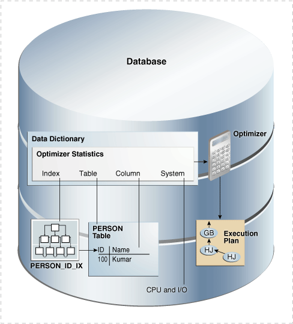
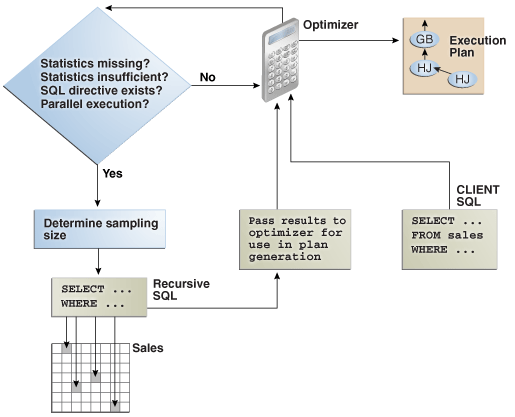

Oracle Database **optimizer statistics** describe details about the database and its objects.

This chapter includes the following topics:

### 10.1 Introduction to Optimizer Statistics

The optimizer cost model relies on statistics collected about the objects involved in a query, and the database and host where the query runs.

The optimizer uses statistics to get an estimate of the number of rows (and number of bytes) retrieved from a table, partition, or index. The optimizer estimates the cost for the access, determines the cost for possible plans, and then picks the [execution plan](glossary.md) with the lowest cost.

Optimizer statistics include the following:

- Table statistics
	- Number of rows
		- Number of blocks
		- Average row length
- Column statistics
	- Number of distinct values (NDV) in a column
		- Number of nulls in a column
		- Data distribution (histogram)
		- Extended statistics
- Index statistics
	- Number of leaf blocks
		- Number of levels
		- Index clustering factor
- System statistics
	- I/O performance and utilization
		- CPU performance and utilization

As shown in Figure 10-1, the database stores optimizer statistics for tables, columns, indexes, and the system in the data dictionary. You can access these statistics using data dictionary views.

Note:

The optimizer statistics are different from the performance statistics visible through `V$` views.

Figure 10-1 Optimizer Statistics



> This graphic shows a cylinder labeled "Database." Inside the cylinder is a box labeled "Data Dictionary." Inside this box is another labeled "Optimizer Statistics." It contains Index, Table, Column, and System, each of which corresponds to an icon. The Optimizer Statistics box points right to an Optimizer icon. The Optimizer icon points down to an Execution Plan icon.


### 10.2 About Optimizer Statistics Types

The optimizer collects statistics on different types of database objects and characteristics of the database environment.

This section contains the following topics:

#### 10.2.1 Table Statistics

In Oracle Database, table statistics include information about rows and blocks.

The optimizer uses these statistics to determine the cost of table scans and table joins. `DBMS_STATS` can gather statistics for both permanent and temporary tables.

The database tracks all relevant statistics about permanent tables. `DBMS_STATS.GATHER_TABLE_STATS` commits before gathering statistics on permanent tables. For example, table statistics stored in `DBA_TAB_STATISTICS` track the following:

- Number of rows and average row length
	The database uses the row count stored in `DBA_TAB_STATISTICS` when determining [cardinality](glossary.md).
- Number of data blocks
	The optimizer uses the number of data blocks with the `DB_FILE_MULTIBLOCK_READ_COUNT` initialization parameter to determine the base table access cost.

Example 10-1 Table Statistics

This example queries some table statistics for the `sh.customers` table.

```
sys@PROD> SELECT NUM_ROWS, AVG_ROW_LEN, BLOCKS, LAST_ANALYZED
  2  FROM   DBA_TAB_STATISTICS
  3  WHERE  OWNER='SH'
  4  AND    TABLE_NAME='CUSTOMERS';
 
  NUM_ROWS AVG_ROW_LEN     BLOCKS LAST_ANAL
---------- ----------- ---------- ---------
     55500         181       1486 14-JUN-10
```

See Also:

- " [About Optimizer Initialization Parameters](influencing-the-optimizer.md) "
- " [Gathering Schema and Table Statistics](gathering-optimizer-statistics.md) "
- [Oracle Database Reference](https://docs.oracle.com/pls/topic/lookup?ctx=en/database/oracle/oracle-database/12.2/tgsql&id=REFRN23376) for a description of the `DBA_TAB_STATISTICS` view and the `DB_FILE_MULTIBLOCK_READ_COUNT` initialization parameter

#### 10.2.2 Column Statistics

Column statistics track information about column values and data distribution.

The optimizer uses column statistics to generate accurate cardinality estimates and make better decisions about index usage, join orders, join methods, and so on. For example, statistics in `DBA_TAB_COL_STATISTICS` track the following:

- Number of distinct values
- Number of nulls
- High and low values
- Histogram-related information

The optimizer can use [extended statistics](glossary.md), which are a special type of column statistics. These statistics are useful for informing the optimizer of logical relationships among columns.

See Also:

- " [Histograms](https://docs.oracle.com/en/database/oracle/oracle-database/12.2/tgsql/histograms.html#GUID-BE10EBFC-FEFC-4530-90DF-1443D9AD9B64 "A histogram is a special type of column statistic that provides more detailed information about the data distribution in a table column. A histogram sorts values into \"buckets,\" as you might sort coins into buckets.") "
- " [About Statistics on Column Groups](managing-extended-statistics.md) "
- [Oracle Database Reference](https://docs.oracle.com/pls/topic/lookup?ctx=en/database/oracle/oracle-database/12.2/tgsql&id=REFRN23376) for a description of the `DBA_TAB_COL_STATISTICS` view

#### 10.2.3 Index Statistics

The **index statistics** include information about the number of index levels, the number of index blocks, and the relationship between the index and the data blocks. The optimizer uses these statistics to determine the cost of index scans.

This section contains the following topics:

##### 10.2.3.1 Types of Index Statistics

The `DBA_IND_STATISTICS` view tracks index statistics.

Statistics include the following:

- Levels
	The `BLEVEL` column shows the number of blocks required to go from the root block to a leaf block. A B-tree index has two types of blocks: branch blocks for searching and leaf blocks that store values. See [Oracle Database Concepts](https://docs.oracle.com/pls/topic/lookup?ctx=en/database/oracle/oracle-database/12.2/tgsql&id=CNCPT1170) for a conceptual overview of B-tree indexes.
- Distinct keys
	This columns tracks the number of distinct indexed values. If a unique constraint is defined, and if no `NOT NULL` constraint is defined, then this value equals the number of non-null values.
- Average number of leaf blocks for each distinct indexed key
- Average number of data blocks pointed to by each distinct indexed key

See Also:

[Oracle Database Reference](https://docs.oracle.com/pls/topic/lookup?ctx=en/database/oracle/oracle-database/12.2/tgsql&id=REFRN23376) for a description of the `DBA_IND_STATISTICS` view

Example 10-2 Index Statistics

This example queries some index statistics for the `cust_lname_ix` and `customers_pk` indexes on the `sh.customers` table (sample output included):

```
SELECT INDEX_NAME, BLEVEL, LEAF_BLOCKS AS "LEAFBLK", DISTINCT_KEYS AS "DIST_KEY",
       AVG_LEAF_BLOCKS_PER_KEY AS "LEAFBLK_PER_KEY",
       AVG_DATA_BLOCKS_PER_KEY AS "DATABLK_PER_KEY"
FROM   DBA_IND_STATISTICS
WHERE  OWNER = 'SH'
AND    INDEX_NAME IN ('CUST_LNAME_IX','CUSTOMERS_PK');

INDEX_NAME     BLEVEL LEAFBLK DIST_KEY LEAFBLK_PER_KEY DATABLK_PER_KEY
-------------- ------ ------- -------- --------------- ---------------
CUSTOMERS_PK        1     115    55500               1               1
CUST_LNAME_IX       1     141      908               1              10
```

##### 10.2.3.2 Index Clustering Factor

For a B-tree index, the **index clustering factor** measures the physical grouping of rows in relation to an index value, such as last name.

The index clustering factor helps the optimizer decide whether an index scan or full table scan is more efficient for certain queries). A low clustering factor indicates an efficient index scan.

A clustering factor that is close to the number of blocks in a table indicates that the rows are physically ordered in the table blocks by the index key. If the database performs a [full table scan](glossary.md), then the database tends to retrieve the rows as they are stored on disk sorted by the index key. A clustering factor that is close to the number of rows indicates that the rows are scattered randomly across the database blocks in relation to the index key. If the database performs a full table scan, then the database would not retrieve rows in any sorted order by this index key.

The clustering factor is a property of a specific index, not a table. If multiple indexes exist on a table, then the clustering factor for one index might be small while the factor for another index is large. An attempt to reorganize the table to improve the clustering factor for one index may degrade the clustering factor of the other index.

Example 10-3 Index Clustering Factor

This example shows how the optimizer uses the index clustering factor to determine whether using an index is more effective than a full table scan.

1. Start SQL\*Plus and connect to a database as `sh`, and then query the number of rows and blocks in the `sh.customers` table (sample output included):
	```
	SELECT  table_name, num_rows, blocks
	FROM    user_tables
	WHERE   table_name='CUSTOMERS';
	 
	TABLE_NAME                       NUM_ROWS     BLOCKS
	------------------------------ ---------- ----------
	CUSTOMERS                           55500       1486
	```
2. Create an index on the `customers.cust_last_name` column.
	For example, execute the following statement:
	```
	CREATE INDEX CUSTOMERS_LAST_NAME_IDX ON customers(cust_last_name);
	```
3. Query the index clustering factor of the newly created index.
	The following query shows that the `customers_last_name_idx` index has a high clustering factor because the clustering factor is significantly more than the number of blocks in the table:
	```
	SELECT index_name, blevel, leaf_blocks, clustering_factor
	FROM   user_indexes
	WHERE  table_name='CUSTOMERS'
	AND    index_name= 'CUSTOMERS_LAST_NAME_IDX';
	 
	INDEX_NAME                         BLEVEL LEAF_BLOCKS CLUSTERING_FACTOR
	------------------------------ ---------- ----------- -----------------
	CUSTOMERS_LAST_NAME_IDX                 1         141              9859
	```
4. Create a new copy of the `customers` table, with rows ordered by `cust_last_name`.
	For example, execute the following statements:
	```
	DROP TABLE customers3 PURGE;
	CREATE TABLE customers3 AS 
	  SELECT * 
	  FROM   customers 
	  ORDER BY cust_last_name;
	```
5. Gather statistics on the `customers3` table.
	For example, execute the `GATHER_TABLE_STATS` procedure as follows:
	```
	EXEC DBMS_STATS.GATHER_TABLE_STATS(null,'CUSTOMERS3');
	```
6. Query the number of rows and blocks in the `customers3` table.
	For example, enter the following query (sample output included):
	```
	SELECT    TABLE_NAME, NUM_ROWS, BLOCKS
	FROM      USER_TABLES
	WHERE     TABLE_NAME='CUSTOMERS3';
	 
	TABLE_NAME                       NUM_ROWS     BLOCKS
	------------------------------ ---------- ----------
	CUSTOMERS3                          55500       1485
	```
7. Create an index on the `cust_last_name` column of `customers3`.
	For example, execute the following statement:
	```
	CREATE INDEX CUSTOMERS3_LAST_NAME_IDX ON customers3(cust_last_name);
	```
8. Query the index clustering factor of the `customers3_last_name_idx` index.
	The following query shows that the `customers3_last_name_idx` index has a lower clustering factor:
	```
	SELECT INDEX_NAME, BLEVEL, LEAF_BLOCKS, CLUSTERING_FACTOR
	FROM   USER_INDEXES
	WHERE  TABLE_NAME = 'CUSTOMERS3'
	AND    INDEX_NAME = 'CUSTOMERS3_LAST_NAME_IDX';
	 
	INDEX_NAME                         BLEVEL LEAF_BLOCKS CLUSTERING_FACTOR
	------------------------------ ---------- ----------- -----------------
	CUSTOMERS3_LAST_NAME_IDX                1         141              1455
	```
	The table `customers3` has the same data as the original `customers` table, but the index on `customers3` has a much lower clustering factor because the data in the table is ordered by the `cust_last_name`. The clustering factor is now about 10 times the number of blocks instead of 70 times.
9. Query the `customers` table.
	For example, execute the following query (sample output included):
	```
	SELECT cust_first_name, cust_last_name
	FROM   customers
	WHERE  cust_last_name BETWEEN 'Puleo' AND 'Quinn';
	 
	CUST_FIRST_NAME      CUST_LAST_NAME
	-------------------- ----------------------------------------
	Vida                 Puleo
	Harriett             Quinlan
	Madeleine            Quinn
	Caresse              Puleo
	```
10. Display the cursor for the query.
	For example, execute the following query (partial sample output included):
	```
	SELECT * FROM TABLE(DBMS_XPLAN.DISPLAY_CURSOR());
	-------------------------------------------------------------------------------
	| Id | Operation                 | Name      | Rows |Bytes|Cost (%CPU)| Time  |
	-------------------------------------------------------------------------------
	|   0| SELECT STATEMENT          |           |      |     | 405 (100)|        |
	|*  1|  TABLE ACCESS STORAGE FULL| CUSTOMERS |  2335|35025| 405   (1)|00:00:01|
	-------------------------------------------------------------------------------
	```
	The preceding plan shows that the optimizer did not use the index on the original `customers` tables.
11. Query the `customers3` table.
	For example, execute the following query (sample output included):
	```
	SELECT cust_first_name, cust_last_name
	FROM   customers3
	WHERE  cust_last_name BETWEEN 'Puleo' AND 'Quinn';
	 
	CUST_FIRST_NAME      CUST_LAST_NAME
	-------------------- ----------------------------------------
	Vida                 Puleo
	Harriett             Quinlan
	Madeleine            Quinn
	Caresse              Puleo
	```
12. Display the cursor for the query.
	For example, execute the following query (partial sample output included):
	```
	SELECT * FROM TABLE(DBMS_XPLAN.DISPLAY_CURSOR());
	---------------------------------------------------------------------------------------
	|Id| Operation                   | Name                   |Rows|Bytes|Cost(%CPU)| Time|
	---------------------------------------------------------------------------------------
	| 0| SELECT STATEMENT            |                        |    |     |69(100)|        |
	| 1|  TABLE ACCESS BY INDEX ROWID|CUSTOMERS3              |2335|35025|69(0)  |00:00:01|
	|*2|   INDEX RANGE SCAN          |CUSTOMERS3_LAST_NAME_IDX|2335|     |7(0)   |00:00:01|
	---------------------------------------------------------------------------------------
	```
	The result set is the same, but the optimizer chooses the index. The plan cost is much less than the cost of the plan used on the original `customers` table.
13. Query `customers` with a hint that forces the optimizer to use the index.
	For example, execute the following query (partial sample output included):
	```
	SELECT /*+ index (Customers CUSTOMERS_LAST_NAME_IDX) */ cust_first_name, 
	       cust_last_name 
	FROM   customers 
	WHERE  cust_last_name BETWEEN 'Puleo' and 'Quinn';
	 
	CUST_FIRST_NAME      CUST_LAST_NAME
	-------------------- ----------------------------------------
	Vida                 Puleo
	Caresse              Puleo
	Harriett             Quinlan
	Madeleine            Quinn
	```
14. Display the cursor for the query.
	For example, execute the following query (partial sample output included):
	```
	SELECT * FROM TABLE(DBMS_XPLAN.DISPLAY_CURSOR());
	---------------------------------------------------------------------------------------
	| Id | Operation                | Name                  |Rows|Bytes|Cost(%CPU)|Time   |
	---------------------------------------------------------------------------------------
	| 0| SELECT STATEMENT            |                       |    |     |422(100)|        |
	| 1|  TABLE ACCESS BY INDEX ROWID|CUSTOMERS              |335 |35025|422(0)  |00:00:01|
	|*2|   INDEX RANGE SCAN          |CUSTOMERS_LAST_NAME_IDX|2335|     |7(0)    |00:00:01|
	---------------------------------------------------------------------------------------
	```
	The preceding plan shows that the cost of using the index on `customers` is higher than the cost of a full table scan. Thus, using an index does not necessarily improve performance. The index clustering factor is a measure of whether an index scan is more effective than a full table scan.

##### 10.2.3.3 Effect of Index Clustering Factor on Cost: Example

This example illustrates how the index clustering factor can influence the cost of table access.

Consider the following scenario:

- A table contains 9 rows that are stored in 3 data blocks.
- The `col1` column currently stores the values `A`, `B`, and `C`.
- A nonunique index named `col1_idx` exists on `col1` for this table.

Example 10-4 Collocated Data

Assume that the rows are stored in the data blocks as follows:

```
Block 1       Block 2        Block 3
-------       -------        -------
A  A  A       B  B  B        C  C  C
```

In this example, the index clustering factor for `col1_idx` is low. The rows that have the same indexed column values for `col1` are in the same data blocks in the table. Thus, the cost of using an index range scan to return all rows with value `A` is low because only one block in the table must be read.

Example 10-5 Scattered Data

Assume that the same rows are scattered across the data blocks as follows:

```
Block 1       Block 2        Block 3
-------       -------        -------
A  B  C       A  C  B        B  A  C
```

In this example, the index clustering factor for `col1_idx` is higher. The database must read all three blocks in the table to retrieve all rows with the value `A` in `col1`.

See Also:

[Oracle Database Reference](https://docs.oracle.com/pls/topic/lookup?ctx=en/database/oracle/oracle-database/12.2/tgsql&id=REFRN23376) for a description of the `DBA_INDEXES` view

#### 10.2.4 Session-Specific Statistics for Global Temporary Tables

A **global temporary table** is a special table that stores intermediate session-private data for a specific duration.

The `ON COMMIT` clause of `CREATE GLOBAL TEMPORARY TABLE` indicates whether the table is transaction-specific (`DELETE ROWS`) or session-specific (`PRESERVE ROWS`). Thus, a temporary table holds intermediate result sets for the duration of either a transaction or a session.

When you create a global temporary table, you create a definition that is visible to all sessions. No physical storage is allocated. When a session first puts data into the table, the database allocates storage space. The data in the temporary table is only visible to the current session.

This section contains the following topics:

##### 10.2.4.1 Shared and Session-Specific Statistics for Global Temporary Tables

Starting in Oracle Database 12c, you can set the table-level preference `GLOBAL_TEMP_TABLE_STATS` to make statistics on a global temporary table shared (`SHARED`) or session-specific (`SESSION`).

When set to session-specific, you can gather statistics for a global temporary table in one session, and then use the statistics for this session only. Meanwhile, users can continue to maintain a shared version of the statistics. During optimization, the optimizer first checks whether a global temporary table has session-specific statistics. If yes, the optimizer uses them. Otherwise, the optimizer uses shared statistics if they exist.

Session-specific statistics have the following characteristics:

- Dictionary views that track statistics show both the shared statistics and the session-specific statistics in the current session.
	The views are `DBA_TAB_STATISTICS`, `DBA_IND_STATISTICS`, `DBA_TAB_HISTOGRAMS`, and `DBA_TAB_COL_STATISTICS` (each view has a corresponding `USER_` and `ALL_` version). The `SCOPE` column shows whether statistics are session-specific or shared.
- Other sessions do not share the cursor using the session-specific statistics.
	Different sessions can share the cursor using shared statistics, as in releases earlier than Oracle Database 12c. The same session can share the cursor using session-specific statistics.
- Pending statistics are not supported for session-specific statistics.
- When the `GLOBAL_TEMP_TABLE_STATS` preference is set to `SESSION`, by default `GATHER_TABLE_STATS` immediately invalidates previous cursors compiled in the same session. However, this procedure does not invalidate cursors compiled in other sessions.

##### 10.2.4.2 Effect of DBMS\_STATS on Transaction-Specific Temporary Tables

`DBMS_STATS` commits changes to session-specific global temporary tables, but not to transaction-specific global temporary tables.

Before Oracle Database 12c, running `DBMS_STATS.GATHER_TABLE_STATS` on a transaction-specific temporary table (`ON COMMIT DELETE ROWS`) would delete all rows, making the statistics show the table as empty. Starting in Oracle Database 12c, the following procedures do not commit for transaction-specific temporary tables, so that rows in these tables are not deleted:

- `GATHER_TABLE_STATS`
- `DELETE_TABLE_STATS`
- `DELETE_COLUMN_STATS`
- `DELETE_INDEX_STATS`
- `SET_TABLE_STATS`
- `SET_COLUMN_STATS`
- `SET_INDEX_STATS`
- `GET_TABLE_STATS`
- `GET_COLUMN_STATS`
- `GET_INDEX_STATS`

The preceding program units observe the `GLOBAL_TEMP_TABLE_STATS` preference. For example, if the table preference is set to `SESSION`, then `SET_TABLE_STATS` sets the session statistics, and `GATHER_TABLE_STATS` preserves all rows in a transaction-specific temporary table. If the table preference is set to `SHARED`, then `SET_TABLE_STATS` sets the shared statistics, and `GATHER_TABLE_STATS` deletes all rows from a transaction-specific temporary table.

See Also:

- " [Gathering Schema and Table Statistics](gathering-optimizer-statistics.md) "
- [Oracle Database Concepts](https://docs.oracle.com/pls/topic/lookup?ctx=en/database/oracle/oracle-database/12.2/tgsql&id=CNCPT88820) to learn about global temporary tables
- [Oracle Database PL/SQL Packages and Types Reference](https://docs.oracle.com/pls/topic/lookup?ctx=en/database/oracle/oracle-database/12.2/tgsql&id=ARPLS68582) to learn about the `DBMS_STATS.GATHER_TABLE_STATS` procedure

#### 10.2.5 System Statistics

The system statistics describe hardware characteristics such as I/O and CPU performance and utilization.

System statistics enable the query optimizer to more accurately estimate I/O and CPU costs when choosing execution plans. The database does not invalidate previously parsed SQL statements when updating system statistics. The database parses all new SQL statements using new statistics.

See Also:

- " [Gathering System Statistics Manually](gathering-optimizer-statistics.md) "
- [Oracle Database Reference](https://docs.oracle.com/pls/topic/lookup?ctx=en/database/oracle/oracle-database/12.2/tgsql&id=TGDBA-GUID-3FEB7C53-D5B3-4540-BD67-8FCBB2917695)

#### 10.2.6 User-Defined Optimizer Statistics

The extensible optimizer enables authors of user-defined functions and indexes to create statistics collection, selectivity, and cost functions. The optimizer cost model is extended to integrate information supplied by the user to assess CPU and the I/O cost.

Statistics types act as interfaces for user-defined functions that influence the choice of execution plan. However, to use a statistics type, the optimizer requires a mechanism to bind the type to a database object such as a column, standalone function, object type, index, indextype, or package. The SQL statement [`ASSOCIATE STATISTICS`](https://docs.oracle.com/pls/topic/lookup?ctx=en/database/oracle/oracle-database/12.2/tgsql&id=SQLRF01106) allows this binding to occur.

Functions for user-defined statistics are relevant for columns that use both standard SQL data types and object types, and for domain indexes. When you associate a statistics type with a column or domain index, the database calls the statistics collection method in the statistics type whenever `DBMS_STATS` gathers statistics.

See Also:

- " [Gathering Schema and Table Statistics](gathering-optimizer-statistics.md) "
- [Oracle Database Data Cartridge Developer's Guide](https://docs.oracle.com/pls/topic/lookup?ctx=en/database/oracle/oracle-database/12.2/tgsql&id=ADDCI2110) to learn about the extensible optimizer and user-defined statistics

### 10.3 How the Database Gathers Optimizer Statistics

Oracle Database provides several mechanisms to gather statistics.

This section contains the following topics:

#### 10.3.1 DBMS\_STATS Package

The `DBMS_STATS` PL/SQL package collects and manages optimizer statistics.

This package enables you to control what and how statistics are collected, including the degree of parallelism for statistics collection, sampling methods, granularity of statistics collection in partitioned tables, and so on.

Note:

Do not use the `COMPUTE` and `ESTIMATE` clauses of the `ANALYZE` statement to collect optimizer statistics. These clauses have been deprecated. Instead, use `DBMS_STATS`.

Statistics gathered with the `DBMS_STATS` package are required for the creation of accurate execution plans. For example, table statistics gathered by `DBMS_STATS` include the number of rows, number of blocks, and average row length.

By default, Oracle Database uses [automatic optimizer statistics collection](glossary.md). In this case, the database automatically runs `DBMS_STATS` to collect optimizer statistics for all schema objects for which statistics are missing or stale. The process eliminates many manual tasks associated with managing the optimizer, and significantly reduces the risks of generating suboptimal execution plans because of missing or stale statistics. You can also update and manage optimizer statistics by manually executing `DBMS_STATS`.

See Also:

- " [Configuring Automatic Optimizer Statistics Collection](gathering-optimizer-statistics.md) "
- " [Gathering Optimizer Statistics Manually](gathering-optimizer-statistics.md) "
- [Oracle Database Administrator’s Guide](https://docs.oracle.com/pls/topic/lookup?ctx=en/database/oracle/oracle-database/12.2/tgsql&id=ADMIN12331) to learn more about automated maintenance tasks
- [Oracle Database PL/SQL Packages and Types Reference](https://docs.oracle.com/pls/topic/lookup?ctx=en/database/oracle/oracle-database/12.2/tgsql&id=ARPLS059) to learn about `DBMS_STATS`

#### 10.3.2 Supplemental Dynamic Statistics

By default, when optimizer statistics are missing, stale, or insufficient, the database automatically gathers dynamic statistics during a parse. The database uses recursive SQL to scan a small random sample of table blocks.

Note:

Dynamic statistics augment statistics rather than providing an alternative to them.

Dynamic statistics supplement optimizer statistics such as table and index block counts, table and join cardinalities (estimated number of rows), join column statistics, and `GROUP BY` statistics. This information helps the optimizer improve plans by making better estimates for predicate cardinality.

Dynamic statistics are beneficial in the following situations:

- An execution plan is suboptimal because of complex predicates.
- The sampling time is a small fraction of total execution time for the query.
- The query executes many times so that the sampling time is amortized.

#### 10.3.3 Online Statistics Gathering for Bulk Loads

Starting in Oracle Database 12c, the database can gather table statistics automatically during the following types of bulk loads: `INSERT INTO ... SELECT` into an empty table using a direct path insert, and `CREATE TABLE AS SELECT`.

Note:

By default, a parallel insert uses a direct path insert. You can force a direct path insert by using the `/*+APPEND*/` hint.

This section contains the following topics:

See Also:

[Oracle Database Data Warehousing Guide](https://docs.oracle.com/pls/topic/lookup?ctx=en/database/oracle/oracle-database/12.2/tgsql&id=DWHSG8382) to learn more about bulk loads

##### 10.3.3.1 Purpose of Online Statistics Gathering for Bulk Loads

Data warehouses typically load large amounts of data into the database. For example, a sales data warehouse might load sales data nightly.

In releases earlier than Oracle Database 12c, to avoid the possibility of a suboptimal plan caused by stale statistics, you needed to gather statistics manually after a bulk load. The ability to gather statistics automatically during bulk loads has the following benefits:

- Improved performance
	Gathering statistics during the load avoids an additional table scan to gather table statistics.
- Improved manageability
	No user intervention is required to gather statistics after a bulk load.

##### 10.3.3.2 Global Statistics During Inserts into Empty Partitioned Tables

When inserting rows into an empty partitioned table, the database gathers global statistics during the insert.

For example, if `sales` is an empty partitioned table, and if you run `INSERT INTO sales SELECT`, then the database gathers global statistics for `sales`. However, the database does not gather partition-level statistics.

Assume a different case in which you use extended syntax to insert rows into a particular partition or subpartition, which is empty. The database gathers statistics on the empty partition during the insert. However, the database does not gather global statistics.

Assume that you run `INSERT INTO sales PARTITION (sales_q4_2000) SELECT`. If partition `sales_q4_2000` is empty before the insert (other partitions need not be empty), then the database gathers statistics during the insert. Moreover, if the `INCREMENTAL` preference is enabled for `sales`, then the database also gathers a [synopsis](glossary.md) for `sales_q4_2000`. Statistics are immediately available after the `INSERT` statement. However, if you roll back the transaction, then the database automatically deletes statistics gathered during the bulk load.

See Also:

- " [Considerations for Incremental Statistics Maintenance](gathering-optimizer-statistics.md) "
- [Oracle Database SQL Language Reference](https://docs.oracle.com/pls/topic/lookup?ctx=en/database/oracle/oracle-database/12.2/tgsql&id=SQLRF01604) for `INSERT` syntax and semantics

##### 10.3.3.3 Index Statistics and Histograms During Bulk Loads

While gathering online statistics, the database does not gather index statistics or create histograms. If these statistics are required, then Oracle recommends running `DBMS_STATS.GATHER_TABLE_STATS` with the `options` parameter set to `GATHER AUTO` after the bulk load.

For example, the following command gathers statistics for the bulk-loaded `sh_ctas` table:

```
EXEC DBMS_STATS.GATHER_TABLE_STATS( user, 'SH_CTAS', options => 'GATHER AUTO' );
```

The preceding example only gathers missing or stale statistics. The database does not gather table and basic column statistics collected during the bulk load.

Note:

You can set the table preference `options` to `GATHER AUTO` on the tables that you plan to bulk load. In this way, you need not explicitly set the `options` parameter when running `GATHER_TABLE_STATS`.

See Also:

- " [Gathering Schema and Table Statistics](gathering-optimizer-statistics.md) "
- [Oracle Database Data Warehousing Guide](https://docs.oracle.com/pls/topic/lookup?ctx=en/database/oracle/oracle-database/12.2/tgsql&id=DWHSG-GUID-0C48B004-54C8-48A3-BBF8-6C69BB19F15E) to learn more about bulk loading

##### 10.3.3.4 Restrictions for Online Statistics Gathering for Bulk Loads

In some situations, optimizer statistics gathering does not occur automatically for bulk loads.

Specifically, bulk loads do not gather statistics automatically when any of the following conditions applies to the target table, partition, or subpartition:

- It is not empty, and you perform an `INSERT INTO ... SELECT`.
	In this case, an `OPTIMIZER STATISTICS GATHERING` row source appears in the plan, but this row source is only a pass-through. The database does not actually gather optimizer statistics.
	Note:
	The `DBA_TAB_COL_STATISTICS.NOTES` column is set to `STATS_ON_LOAD` by a bulk load into an empty table. However, subsequent bulk loads into the non-empty table do not reset the `NOTES` column. One technique for determining whether the database gathered statistics is to query the `USER_TAB_MODIFICATIONS.INSERTS` column. If the query returns a row indicating the number of rows loaded, then the most recent bulk load did not gather statistics automatically.
- It is loaded using an `INSERT INTO ... SELECT`, and neither of the following conditions is true: all columns of the target table are specified, or a subset of the target columns are specified and the unspecified columns have default values.
	Put differently, the database only gathers statistics automatically for bulk loads when either all columns of the target table are specified, or a subset of the target columns are specified and the unspecified columns have default values. For example, the `sales` table has only columns `c1`, `c2`, `c3`, and `c4`. The column `c4` does not have a default value. You load `sales_copy` by executing `INSERT /*+ APPEND */ INTO sales_copy SELECT c1, c2, c3 FROM sales`. In this case, the database does not gather online statistics for `sales_copy`. The database would gather statistics if `c4` had a default value or if it were included in the `SELECT` list.
- It is in an Oracle-owned schema such as `SYS`.
- It is one of the following types of tables: nested table, index-organized table (IOT), external table, or global temporary table defined as `ON COMMIT DELETE ROWS`.
- It has a `PUBLISH` preference set to `FALSE`.
- Its statistics are locked.
- It is partitioned, `INCREMENTAL` is set to `true`, and partition-extended syntax is not used.
	For example, assume that you execute `DBMS_STATS.SET_TABLE_PREFS(null, 'sales', incremental', 'true')`. In this case, the database does not gather statistics for `INSERT INTO sales SELECT`, even when `sales` is empty. However, the database does gather statistics automatically for `INSERT INTO sales PARTITION` `(sales_q4_2000) SELECT`.
- It is loaded using a multitable `INSERT` statement.

See Also:

- " [Gathering Schema and Table Statistics](gathering-optimizer-statistics.md) "
- [Oracle Database PL/SQL Packages and Types Reference](https://docs.oracle.com/pls/topic/lookup?ctx=en/database/oracle/oracle-database/12.2/tgsql&id=ARPLS-GUID-CDAA4742-5398-4A64-B871-E39F38D0021F) to learn more about `DBMS_STATS.SET_TABLE_PREFS`

##### 10.3.3.5 Hints for Online Statistics Gathering for Bulk Loads

By default, the database gathers statistics during bulk loads. You can disable the feature at the statement level by using the `NO_GATHER_OPTIMIZER_STATISTICS` hint, and enable the feature at the statement level by using the `GATHER_OPTIMIZER_STATISTICS` hint.

For example, the following statement disables online statistics gathering for bulk loads:

```
CREATE TABLE employees2 AS
  SELECT /*+NO_GATHER_OPTIMIZER_STATISTICS*/ * FROM employees
```

See Also:

[Oracle Database SQL Language Reference](https://docs.oracle.com/pls/topic/lookup?ctx=en/database/oracle/oracle-database/12.2/tgsql&id=SQLRF56406) to learn about the `GATHER_OPTIMIZER_STATISTICS` and `NO_GATHER_OPTIMIZER_STATISTICS` hints

### 10.4 When the Database Gathers Optimizer Statistics

The database collects optimizer statistics at various times and from various sources.

This section contains the following topics:

#### 10.4.1 Sources for Optimizer Statistics

The optimizer uses several different sources for optimizer statistics.

The sources are as follows:

- `DBMS_STATS` execution, automatic or manual
	This PL/SQL package is the primary means of gathering optimizer statistics.
- SQL compilation
	During [SQL compilation](glossary.md), the database can augment the statistics previously gathered by `DBMS_STATS`. In this stage, the database runs additional queries to obtain more accurate information on how many rows in the tables satisfy the `WHERE` clause predicates in the SQL statement.
- SQL execution
	During execution, the database can further augment previously gathered statistics. In this stage, Oracle Database collects the number of rows produced by every row source during the execution of a SQL statement. At the end of execution, the optimizer determines whether the estimated number of rows is inaccurate enough to warrant reparsing at the next statement execution. If the cursor is marked for reparsing, then the optimizer uses actual row counts from the previous execution instead of estimates.
- SQL profiles
	A [SQL profile](glossary.md) is a collection of auxiliary statistics on a query. The profile stores these supplemental statistics in the data dictionary. The optimizer uses SQL profiles during optimization to determine the most optimal plan.

The database stores optimizer statistics in the data dictionary and updates or replaces them as needed. You can query statistics in data dictionary views.

See Also:

- " When the Database Samples Data "
- " [About SQL Profiles](managing-sql-profiles.md) "
- [Oracle Database PL/SQL Packages and Types Reference](https://docs.oracle.com/pls/topic/lookup?ctx=en/database/oracle/oracle-database/12.2/tgsql&id=ARPLS-GUID-CA6A56B9-0540-45E9-B1D7-D78769B7714C) to learn about the `DBMS_STATS.GATHER_TABLE_STATS` procedure

#### 10.4.2 SQL Plan Directives

A **SQL plan directive** is additional information and instructions that the optimizer can use to generate a more optimal plan.

The directive is a “note to self” by the optimizer that it is misestimating cardinalities of certain types of predicates, and also a reminder to `DBMS_STATS` to gather statistics needed to correct the misestimates in the future. For example, when joining two tables that have a data skew in their join columns, a SQL plan directive can direct the optimizer to use dynamic statistics to obtain a more accurate join cardinality estimate.

This section contains the following topics:

##### 10.4.2.1 When the Database Creates SQL Plan Directives

The database creates SQL plan directives automatically based on information learned during automatic reoptimization. If a cardinality misestimate occurs during SQL execution, then the database creates SQL plan directives.

For each new directive, the `DBA_SQL_PLAN_DIRECTIVES.STATE` column shows the value `USABLE`. This value indicates that the database can use the directive to correct misestimates.

The optimizer defines a SQL plan directive on a query expression, for example, filter predicates on two columns being used together. A directive is not tied to a specific SQL statement or SQL ID. For this reason, the optimizer can use directives for statements that are not identical. For example, directives can help the optimizer with queries that use similar patterns, such as queries that are identical except for a select list item.

The Notes section of the execution plan indicates the number of SQL plan directives used for a statement. Obtain more information about the directives by querying the `DBA_SQL_PLAN_DIRECTIVES` and `DBA_SQL_PLAN_DIR_OBJECTS` views.

See Also:

[Oracle Database Reference](https://docs.oracle.com/pls/topic/lookup?ctx=en/database/oracle/oracle-database/12.2/tgsql&id=REFRN-GUID-70035A22-E031-4975-A51C-871AE1F2F260) to learn more about `DBA_SQL_PLAN_DIRECTIVES`

##### 10.4.2.2 How the Database Uses SQL Plan Directives

When compiling a SQL statement, if the optimizer sees a directive, then it obeys the directive by gathering additional information.

The optimizer uses directives in the following ways:

- Dynamic statistics
	The optimizer uses dynamic statistics whenever it does not have sufficient statistics corresponding to the directive. For example, the cardinality estimates for a query whose predicate contains a specific pair of columns may be significantly wrong. A SQL plan directive indicates that the whenever a query that contains these columns is parsed, the optimizer needs to use dynamic sampling to avoid a serious cardinality misestimate.
	Dynamic statistics have some performance overhead. Every time the optimizer hard parses a query to which a dynamic statistics directive applies, the database must perform the extra sampling.
	Starting in Oracle Database 12c Release 2 (12.2), the database writes statistics from [adaptive dynamic sampling](glossary.md) to the SQL plan directives store, making them available to other queries.
- Column groups
	The optimizer examines the query corresponding to the directive. If there is a missing [column group](glossary.md), and if the `DBMS_STATS` preference `AUTO_STAT_EXTENSIONS` is set to `ON` (the default is `OFF`) for the affected table, then the optimizer automatically creates this column group the next time `DBMS_STATS` gathers statistics on the table. Otherwise, the optimizer does not automatically create the column group.
	If a column group exists, then the next time this statement executes, the optimizer uses the [column group statistics](glossary.md) in place of the SQL plan directive when possible (equality predicates, `GROUP BY`, and so on). In subsequent executions, the optimizer may create additional SQL plan directives to address other problems in the plan, such as join or `GROUP BY` cardinality misestimates.
	Note:
	Currently, the optimizer monitors only column groups. The optimizer does not create an extension on expressions.

When the problem that occasioned a directive is solved, either because a better directive exists or because a histogram or extension exists, the `DBA_SQL_PLAN_DIRECTIVES.STATE` value changes from `USABLE` to `SUPERSEDED`. More information about the directive state is exposed in the `DBA_SQL_PLAN_DIRECTIVES.NOTES` column.

See Also:

- " [Managing Extended Statistics](managing-extended-statistics.md) "
- " [About Statistics on Column Groups](managing-extended-statistics.md) "
- [Oracle Database PL/SQL Packages and Types Reference](https://docs.oracle.com/pls/topic/lookup?ctx=en/database/oracle/oracle-database/12.2/tgsql&id=ARPLS-GUID-F993ADFE-85A9-4939-84D1-CC7A6E5C56D2) to learn more about the `AUTO_STAT_EXTENSIONS` preference for `DBMS_STATS.SET_TABLE_STATS`

##### 10.4.2.3 SQL Plan Directive Maintenance

The database automatically creates SQL plan directives. You cannot create them manually.

The database initially creates directives in the shared pool. The database periodically writes the directives to the `SYSAUX` tablespace. The database automatically purges any SQL plan directive that is not used after the specified number of weeks (`SPD_RETENTION_WEEKS`), which is 53 by default.

You can manage directives by using the `DBMS_SPD` package. For example, you can:

- Enable and disable SQL plan directives (`ALTER_SQL_PLAN_DIRECTIVE`)
- Change the retention period for SQL plan directives (`SET_PREFS`)
- Export a directive to a staging table (`PACK_STGTAB_DIRECTIVE`)
- Drop a directive (`DROP_SQL_PLAN_DIRECTIVE`)
- Force the database to write directives to disk (`FLUSH_SQL_PLAN_DIRECTIVE`)

See Also:

[Oracle Database PL/SQL Packages and Types Reference](https://docs.oracle.com/pls/topic/lookup?ctx=en/database/oracle/oracle-database/12.2/tgsql&id=ARPLS73856) to learn about the `DBMS_SPD` package

##### 10.4.2.4 How the Optimizer Uses SQL Plan Directives: Example

This example shows how the database automatically creates and uses SQL plan directives for SQL statements.

Assumptions

You plan to run queries against the `sh` schema, and you have privileges on this schema and on data dictionary and `V$` views.

To see how the database uses a SQL plan directive:

1. Query the `sh.customers` table.
	```
	SELECT /*+gather_plan_statistics*/ * 
	FROM   customers 
	WHERE  cust_state_province='CA' 
	AND    country_id='US';
	```
	The `gather_plan_statistics` hint shows the actual number of rows returned from each operation in the plan. Thus, you can compare the optimizer estimates with the actual number of rows returned.
2. Query the plan for the preceding query.
	The following example shows the execution plan (sample output included):
	```
	SELECT * FROM TABLE(DBMS_XPLAN.DISPLAY_CURSOR(FORMAT=>'ALLSTATS LAST'));
	 
	PLAN_TABLE_OUTPUT
	-------------------------------------
	SQL_ID  b74nw722wjvy3, child number 0
	-------------------------------------
	select /*+gather_plan_statistics*/ * from customers where
	CUST_STATE_PROVINCE='CA' and country_id='US'
	 
	Plan hash value: 1683234692
	---------------------------------------------------------------------------------------
	| Id| Operation         | Name     |Starts|E-Rows|A-Rows| Time       | Buffers| Reads |
	---------------------------------------------------------------------------------------
	| 0 | SELECT STATEMENT  |           |  1 |     |     29 |00:00:00.01 |     17 |    14 |
	|*1 |  TABLE ACCESS FULL| CUSTOMERS |  1 |   8 |     29 |00:00:00.01 |     17 |    14 |
	---------------------------------------------------------------------------------------
	 
	Predicate Information (identified by operation id):
	---------------------------------------------------
	 
	   1 - filter(("CUST_STATE_PROVINCE"='CA' AND "COUNTRY_ID"='US'))
	```
	The actual number of rows (`A-Rows`) returned by each operation in the plan varies greatly from the estimates (`E-Rows`). This statement is a candidate for [automatic reoptimization](glossary.md).
3. Check whether the `customers` query can be reoptimized.
	The following statement queries the `V$SQL.IS_REOPTIMIZABLE` value (sample output included):
	```
	SELECT SQL_ID, CHILD_NUMBER, SQL_TEXT, IS_REOPTIMIZABLE
	FROM   V$SQL
	WHERE  SQL_TEXT LIKE 'SELECT /*+gather_plan_statistics*/%';
	 
	SQL_ID        CHILD_NUMBER SQL_TEXT    I
	------------- ------------ ----------- -
	b74nw722wjvy3            0 select /*+g Y
	                           ather_plan_
	                           statistics*
	                           / * from cu
	                           stomers whe
	                           re CUST_STA
	                           TE_PROVINCE
	                           ='CA' and c
	                           ountry_id='
	                           US'
	```
	The `IS_REOPTIMIZABLE` column is marked `Y`, so the database will perform a hard parse of the `customers` query on the next execution. The optimizer uses the execution statistics from this initial execution to determine the plan. The database persists the information learned from reoptimization as a SQL plan directive.
4. Display the directives for the `sh` schema.
	The following example uses `DBMS_SPD` to write the SQL plan directives to disk, and then shows the directives for the `sh` schema only:
	```
	EXEC DBMS_SPD.FLUSH_SQL_PLAN_DIRECTIVE;
	 
	SELECT TO_CHAR(d.DIRECTIVE_ID) dir_id, o.OWNER AS "OWN", o.OBJECT_NAME AS "OBJECT", 
	       o.SUBOBJECT_NAME col_name, o.OBJECT_TYPE, d.TYPE, d.STATE, d.REASON
	FROM   DBA_SQL_PLAN_DIRECTIVES d, DBA_SQL_PLAN_DIR_OBJECTS o
	WHERE  d.DIRECTIVE_ID=o.DIRECTIVE_ID
	AND    o.OWNER IN ('SH')
	ORDER BY 1,2,3,4,5;
	DIR_ID              OW OBJECT    COL_NAME   OBJECT TYPE          STATE  REASON
	------------------- -- --------- ---------- ------ ------------- ------ ------------
	1484026771529551585 SH CUSTOMERS COUNTRY_ID COLUMN DYNAMIC_SAMPL USABLE SINGLE TABLE
	                                                                        CARDINALITY
	                                                                        MISESTIMATE
	1484026771529551585 SH CUSTOMERS CUST_STATE COLUMN DYNAMIC_SAMPL USABLE SINGLE TABLE
	                                 _PROVINCE                              CARDINALITY
	                                                                        MISESTIMATE       
	1484026771529551585 SH CUSTOMERS            TABLE  DYNAMIC_SAMPL USABLE SINGLE TABLE
	                                                                        CARDINALITY
	                                                                        MISESTIMATE
	```
	Initially, the database stores SQL plan directives in memory, and then writes them to disk every 15 minutes. Thus, the preceding example calls `DBMS_SPD.FLUSH_SQL_PLAN_DIRECTIVE` to force the database to write the directives to the `SYSAUX` tablespace.
	Monitor directives using the views `DBA_SQL_PLAN_DIRECTIVES` and `DBA_SQL_PLAN_DIR_OBJECTS`. Three entries appear in the views, one for the `customers` table itself, and one for each of the correlated columns. Because the `customers` query has the `IS_REOPTIMIZABLE` value of `Y`, if you reexecute the statement, then the database will hard parse it again, and then generate a plan based on the previous execution statistics.
5. Query the `customers` table again.
	For example, enter the following statement:
	```
	SELECT /*+gather_plan_statistics*/ * 
	FROM   customers 
	WHERE  cust_state_province='CA' 
	AND    country_id='US';
	```
6. Query the plan in the cursor.
	The following example shows the execution plan (sample output included):
	```
	SELECT * FROM TABLE(DBMS_XPLAN.DISPLAY_CURSOR(FORMAT=>'ALLSTATS LAST'));
	PLAN_TABLE_OUTPUT
	-------------------------------------
	SQL_ID  b74nw722wjvy3, child number 1
	-------------------------------------
	select /*+gather_plan_statistics*/ * from customers where
	CUST_STATE_PROVINCE='CA' and country_id='US'
	 
	Plan hash value: 1683234692
	------------------------------------------------------------------------
	|Id| Operation         |Name    |Start|E-Rows|A-Rows|  A-Time  |Buffers|
	------------------------------------------------------------------------
	| 0| SELECT STATEMENT  |         |  1|      |    29|00:00:00.01|     17|
	|*1|  TABLE ACCESS FULL|CUSTOMERS|  1|    29|    29|00:00:00.01|     17|
	------------------------------------------------------------------------
	Predicate Information (identified by operation id):
	---------------------------------------------------
	 
	   1 - filter(("CUST_STATE_PROVINCE"='CA' AND "COUNTRY_ID"='US'))
	 
	Note
	-----
	   - cardinality feedback used for this statement
	```
	The `Note` section indicates that the database used reoptimization for this statement. The estimated number of rows (`E-Rows`) is now correct. The SQL plan directive has not been used yet.
7. Query the cursors for the `customers` query.
	For example, run the following query (sample output included):
	```
	SELECT SQL_ID, CHILD_NUMBER, SQL_TEXT, IS_REOPTIMIZABLE
	FROM   V$SQL
	WHERE  SQL_TEXT LIKE 'SELECT /*+gather_plan_statistics*/%';
	 
	SQL_ID        CHILD_NUMBER SQL_TEXT    I
	------------- ------------ ----------- -
	b74nw722wjvy3            0 select /*+g Y
	                           ather_plan_
	                           statistics*
	                           / * from cu
	                           stomers whe
	                           re CUST_STA
	                           TE_PROVINCE
	                           ='CA' and c
	                           ountry_id='
	                           US'
	 
	b74nw722wjvy3            1 select /*+g N
	                           ather_plan_
	                           statistics*
	                           / * from cu
	                           stomers whe
	                           re CUST_STA
	                           TE_PROVINCE
	                           ='CA' and c
	                           ountry_id='
	                           US'
	```
	A new plan exists for the `customers` query, and also a new child cursor.
8. Confirm that a SQL plan directive exists and is usable for other statements.
	For example, run the following query, which is similar but not identical to the original `customers` query (the state is `MA` instead of `CA`):
	```
	SELECT /*+gather_plan_statistics*/ CUST_EMAIL
	FROM   CUSTOMERS
	WHERE  CUST_STATE_PROVINCE='MA'
	AND    COUNTRY_ID='US';
	```
9. Query the plan in the cursor.
	The following statement queries the cursor (sample output included).:
	```
	SELECT * FROM TABLE(DBMS_XPLAN.DISPLAY_CURSOR(FORMAT=>'ALLSTATS LAST'));
	PLAN_TABLE_OUTPUT
	-------------------------------------
	SQL_ID  3tk6hj3nkcs2u, child number 0
	-------------------------------------
	Select /*+gather_plan_statistics*/ cust_email From   customers Where
	cust_state_province='MA' And    country_id='US'
	 
	Plan hash value: 1683234692
	----------------------------------------------------------------------
	|Id | Operation         | Name   |Starts|E-Rows|A-Rows|A-Time|Buffers|
	----------------------------------------------------------------------
	| 0 | SELECT STATEMENT  |           |  1 |   |  2 |00:00:00.01|   16 |
	|*1 |  TABLE ACCESS FULL| CUSTOMERS |  1 | 2 |  2 |00:00:00.01|   16 |
	----------------------------------------------------------------------
	 
	Predicate Information (identified by operation id):
	---------------------------------------------------
	 
	   1 - filter(("CUST_STATE_PROVINCE"='MA' AND "COUNTRY_ID"='US'))
	 
	Note
	-----
	   - dynamic sampling used for this statement (level=2)
	   - 1 Sql Plan Directive used for this statement
	```
	The `Note` section of the plan shows that the optimizer used the SQL directive for this statement, and also used dynamic statistics.

##### 10.4.2.5 How the Optimizer Uses Extensions and SQL Plan Directives: Example

The example shows how the database uses a SQL plan directive until the optimizer verifies that an extension exists and the statistics are applicable.

At this point, the directive changes its status to `SUPERSEDED`. Subsequent compilations use the statistics instead of the directive.

Assumptions

This example assumes you have already followed the steps in " How the Optimizer Uses SQL Plan Directives: Example ".

To see how the optimizer uses an extension and SQL plan directive:

1. Gather statistics for the `sh.customers` table.
	For example, execute the following PL/SQL program:
	```
	BEGIN
	  DBMS_STATS.GATHER_TABLE_STATS('SH','CUSTOMERS');
	END;
	/
	```
2. Check whether an extension exists on the `customers` table.
	For example, execute the following query (sample output included):
	```
	SELECT TABLE_NAME, EXTENSION_NAME, EXTENSION 
	FROM   DBA_STAT_EXTENSIONS
	WHERE  OWNER='SH' 
	AND    TABLE_NAME='CUSTOMERS';
	 
	TABLE_NAM EXTENSION_NAME                 EXTENSION
	--------- ------------------------------ -----------------------
	CUSTOMERS SYS_STU#S#WF25Z#QAHIHE#MOFFMM_ ("CUST_STATE_PROVINCE",
	                                         "COUNTRY_ID")
	```
	The preceding output indicates that a column group extension exists on the `cust_state_province` and `country_id` columns.
3. Query the state of the SQL plan directive.
	Example 10-6 queries the data dictionary for information about the directive.
	Although column group statistics exist, the directive has a state of `USABLE` because the database has not yet recompiled the statement. During the next compilation, the optimizer verifies that the statistics are applicable. If they are applicable, then the status of the directive changes to `SUPERSEDED`. Subsequent compilations use the statistics instead of the directive.
4. Query the `sh.customers` table.
	```
	SELECT /*+gather_plan_statistics*/ * 
	FROM   customers 
	WHERE  cust_state_province='CA' 
	AND    country_id='US';
	```
5. Query the plan in the cursor.
	Example 10-7 shows the execution plan (sample output included).
	The `Note` section shows that the optimizer used the directive and not the extended statistics. During the compilation, the database verified the extended statistics.
6. Query the state of the SQL plan directive.
	Example 10-8 queries the data dictionary for information about the directive.
	The state of the directive, which has changed to `SUPERSEDED`, indicates that the corresponding column or groups have an extension or histogram, or that another SQL plan directive exists that can be used for the directive.
7. Query the `sh.customers` table again, using a slightly different form of the statement.
	For example, run the following query:
	```
	SELECT /*+gather_plan_statistics*/ /* force reparse */ * 
	FROM   customers 
	WHERE  cust_state_province='CA' 
	AND    country_id='US';
	```
	If the cursor is in the shared SQL area, then the database typically shares the cursor. To force a reparse, this step changes the SQL text slightly by adding a comment.
8. Query the plan in the cursor.
	Example 10-9 shows the execution plan (sample output included).
	The absence of a `Note` shows that the optimizer used the extended statistics instead of the SQL plan directive. If the directive is not used for 53 weeks, then the database automatically purges it.

See Also:

- " [Managing SQL Plan Directives](options-for-optimizer-statistics-gathering.md) "
- [Oracle Database Reference](https://docs.oracle.com/pls/topic/lookup?ctx=en/database/oracle/oracle-database/12.2/tgsql&id=REFRN23823) to learn about `DBA_SQL_PLAN_DIRECTIVES`, `V$SQL`, and other database views
- [Oracle Database Reference](https://docs.oracle.com/pls/topic/lookup?ctx=en/database/oracle/oracle-database/12.2/tgsql&id=ARPLS73856) to learn about `DBMS_SPD`

Example 10-6 Display Directives for sh Schema

```
EXEC DBMS_SPD.FLUSH_SQL_PLAN_DIRECTIVE;
 
SELECT TO_CHAR(d.DIRECTIVE_ID) dir_id, o.OWNER, o.OBJECT_NAME, 
       o.SUBOBJECT_NAME col_name, o.OBJECT_TYPE, d.TYPE, d.STATE, d.REASON
FROM   DBA_SQL_PLAN_DIRECTIVES d, DBA_SQL_PLAN_DIR_OBJECTS o
WHERE  d.DIRECTIVE_ID=o.DIRECTIVE_ID
AND    o.OWNER IN ('SH')
ORDER BY 1,2,3,4,5;
 
DIR_ID              OWN OBJECT_NA COL_NAME   OBJECT  TYPE             STATE  REASON
------------------- --- --------- ---------- ------- ---------------- ------ ------------
1484026771529551585  SH CUSTOMERS COUNTRY_ID  COLUMN DYNAMIC_SAMPLING USABLE SINGLE TABLE 
                                                                             CARDINALITY 
                                                                             MISESTIMATE
1484026771529551585  SH CUSTOMERS CUST_STATE_ COLUMN DYNAMIC_SAMPLING USABLE SINGLE TABLE 
                                  PROVINCE                                   CARDINALITY
                                                                             MISESTIMATE
1484026771529551585  SH CUSTOMERS              TABLE DYNAMIC_SAMPLING USABLE SINGLE TABLE 
                                                                             CARDINALITY
                                                                             MISESTIMATE
```

Example 10-7 Execution Plan

```
SQL> SELECT * FROM TABLE(DBMS_XPLAN.DISPLAY_CURSOR(FORMAT=>'ALLSTATS LAST'));
 
PLAN_TABLE_OUTPUT
-------------------------------------
SQL_ID  b74nw722wjvy3, child number 0
-------------------------------------
select /*+gather_plan_statistics*/ * from customers where
CUST_STATE_PROVINCE='CA' and country_id='US'
 
Plan hash value: 1683234692
 
-----------------------------------------------------------------------------------------
| Id  | Operation         | Name      | Starts | E-Rows | A-Rows |   A-Time   | Buffers |
-----------------------------------------------------------------------------------------
|   0 | SELECT STATEMENT  |           |      1 |        |     29 |00:00:00.01 |      16 |
|*  1 |  TABLE ACCESS FULL| CUSTOMERS |      1 |     29 |     29 |00:00:00.01 |      16 |
-----------------------------------------------------------------------------------------
 
Predicate Information (identified by operation id):
---------------------------------------------------
 
   1 - filter(("CUST_STATE_PROVINCE"='CA' AND "COUNTRY_ID"='US'))
 
Note
-----
   - dynamic sampling used for this statement (level=2)
   - 1 Sql Plan Directive used for this statement
```

Example 10-8 Display Directives for sh Schema

```
EXEC DBMS_SPD.FLUSH_SQL_PLAN_DIRECTIVE;
 
SELECT TO_CHAR(d.DIRECTIVE_ID) dir_id, o.OWNER, o.OBJECT_NAME, 
       o.SUBOBJECT_NAME col_name, o.OBJECT_TYPE, d.TYPE, d.STATE, d.REASON
FROM   DBA_SQL_PLAN_DIRECTIVES d, DBA_SQL_PLAN_DIR_OBJECTS o
WHERE  d.DIRECTIVE_ID=o.DIRECTIVE_ID
AND    o.OWNER IN ('SH')
ORDER BY 1,2,3,4,5;
 
DIR_ID              OWN OBJECT_NA  COL_NAME    OBJECT TYPE     STATE      REASON
------------------- --- ---------  ----------  ------ -------- ---------  ------------
1484026771529551585  SH CUSTOMERS  COUNTRY_ID  COLUMN DYNAMIC_ SUPERSEDED SINGLE TABLE  
                                                      SAMPLING            CARDINALITY 
                                                                          MISESTIMATE
1484026771529551585  SH CUSTOMERS  CUST_STATE_ COLUMN DYNAMIC_ SUPERSEDED SINGLE TABLE 
                                   PROVINCE           SAMPLING            CARDINALITY 
                                                                          MISESTIMATE
1484026771529551585  SH CUSTOMERS               TABLE DYNAMIC_ SUPERSEDED SINGLE TABLE
                                                      SAMPLING            CARDINALITY
                                                                          MISESTIMATE
```

Example 10-9 Execution Plan

```
SQL> SELECT * FROM TABLE(DBMS_XPLAN.DISPLAY_CURSOR(FORMAT=>'ALLSTATS LAST'));
 
PLAN_TABLE_OUTPUT
-------------------------------------
SQL_ID  b74nw722wjvy3, child number 0
-------------------------------------
select /*+gather_plan_statistics*/ * from customers where
CUST_STATE_PROVINCE='CA' and country_id='US'
 
Plan hash value: 1683234692
 
-----------------------------------------------------------------------------------------
| Id  | Operation         | Name      | Starts | E-Rows | A-Rows |   A-Time   | Buffers |
-----------------------------------------------------------------------------------------
|   0 | SELECT STATEMENT  |           |      1 |        |     29 |00:00:00.01 |      17 |
|*  1 |  TABLE ACCESS FULL| CUSTOMERS |      1 |     29 |     29 |00:00:00.01 |      17 |
-----------------------------------------------------------------------------------------
 
Predicate Information (identified by operation id):
---------------------------------------------------
 
   1 - filter(("CUST_STATE_PROVINCE"='CA' AND "COUNTRY_ID"='US'))
 
19 rows selected.
```

#### 10.4.3 When the Database Samples Data

Starting in Oracle Database 12c, the optimizer automatically decides whether dynamic statistics are useful and which sample size to use for all SQL statements. In earlier releases, dynamic statistics were called dynamic sampling.

The primary factor in the decision to use dynamic statistics is whether available statistics are sufficient to generate an optimal plan. If statistics are insufficient, then the optimizer uses dynamic statistics.

Automatic dynamic statistics are enabled when the `OPTIMIZER_DYNAMIC_SAMPLING` initialization parameter is not set to `0`. By default, the [dynamic statistics level](glossary.md) is set to `2`.

In general, the optimizer uses default statistics rather than dynamic statistics to compute statistics needed during optimizations on tables, indexes, and columns. The optimizer decides whether to use dynamic statistics based on several factors, including the following:

- The SQL statement uses parallel execution.
- A SQL plan directive exists.

The following diagram illustrates the process of gathering dynamic statistics.

Figure 10-2 Dynamic Statistics



> This graphic shows a diamond that contains the following text: "Statistics missing? Statistics stale? Statistics insufficient? SQL directive exists? Parallel execution?" The diamond points down to a box that contains the text "Determine sampling level." The arrow is labeled "Yes." An arrow leads from "Determine sampling level" down to a box that contains a SQL statement. The box is labeled "Recursive SQL." This box points down to a sales table and shows that some blocks from table are scanned. The diamond points right to an optimizer icon. The arrow is labeled "No." A box below the optimizer contains a SQL statement. It points up to the Optimizer icon. The Optimizer points right to a plan labeled "Execution Plan."


As shown in Figure 10-2, the optimizer automatically gathers dynamic statistics in the following cases:

- Missing statistics
	When tables in a query have no statistics, the optimizer gathers basic statistics on these tables before optimization. Statistics can be missing because the application creates new objects without a follow-up call to `DBMS_STATS` to gather statistics, or because statistics were locked on an object before statistics were gathered.
	In this case, the statistics are not as high-quality or as complete as the statistics gathered using the `DBMS_STATS` package. This trade-off is made to limit the impact on the compile time of the statement.
- Insufficient statistics
	Statistics can be insufficient whenever the optimizer estimates the selectivity of predicates (filter or join) or the `GROUP BY` clause without taking into account correlation between columns, skew in the column data distribution, statistics on expressions, and so on.
	Extended statistics help the optimizer obtain accurate quality cardinality estimates for complex predicate expressions. The optimizer can use dynamic statistics to compensate for the lack of extended statistics or when it cannot use extended statistics, for example, for non-equality predicates.

Note:

The database does not use dynamic statistics for queries that contain the `AS OF` clause.

See Also:

- " [Configuring Options for Dynamic Statistics](options-for-optimizer-statistics-gathering.md) "
- " [About Statistics on Column Groups](managing-extended-statistics.md) "
- [Oracle Database Reference](https://docs.oracle.com/pls/topic/lookup?ctx=en/database/oracle/oracle-database/12.2/tgsql&id=REFRN10140) to learn about the `OPTIMIZER_DYNAMIC_SAMPLING` initialization parameter

#### 10.4.4 How the Database Samples Data

At the beginning of optimization, when deciding whether a table is a candidate for dynamic statistics, the optimizer checks for the existence of persistent SQL plan directives on the table.

For each directive, the optimizer registers a statistics expression that the optimizer computes when determining the cardinality of a predicate involving the table. In Figure 10-2, the database issues a [recursive SQL](glossary.md) statement to scan a small random sample of the table blocks. The database applies the relevant single-table predicates and joins to estimate predicate cardinalities.

The database persists the results of dynamic statistics as sharable statistics. The database can share the results during the [SQL compilation](glossary.md) of one query with recompilations of the same query. The database can also reuse the results for queries that have the same patterns.

See Also:

- " [Configuring Options for Dynamic Statistics](options-for-optimizer-statistics-gathering.md) " to learn how to set the dynamic statistics level
- [Oracle Database Reference](https://docs.oracle.com/pls/topic/lookup?ctx=en/database/oracle/oracle-database/12.2/tgsql&id=REFRN10140) for details about the `OPTIMIZER_DYNAMIC_SAMPLING` initialization parameter